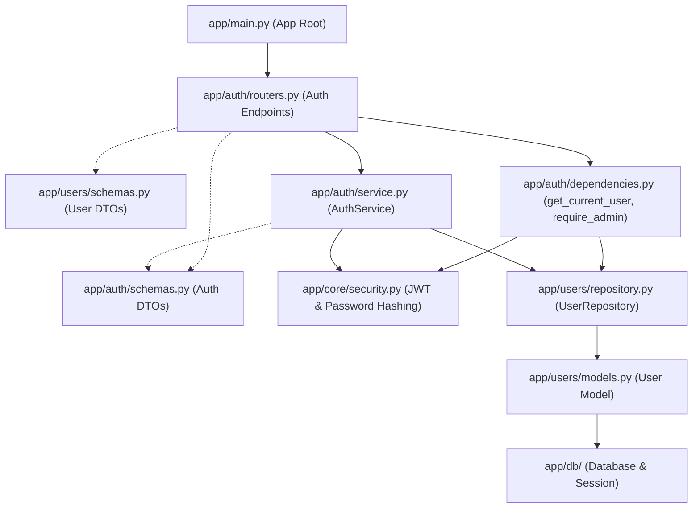

# Authentication Feature API Guide

## Summary
The Authentication feature handles user registration, credential verification (login), JWT access token generation, and current profile retrieval (`/auth/me`). It also provides security utilities for password hashing/verification and FastAPI dependencies for JWT token authentication and role-based access control.

Associated source files:
- Router: `app/auth/routers.py`
- Service: `app/auth/service.py`
- Dependencies: `app/auth/dependencies.py`
- Security Core: `app/core/security.py`
- Schemas: `app/auth/schemas.py`
- User Schemas: `app/users/schemas.py`
- User Repository: `app/users/repository.py`
- User Model: `app/users/models.py`

---

## Schemas

### RegisterRequest
| Field | Type | Required | Rules | Description |
| :--- | :--- | :--- | :--- | :--- |
| `name` | string | Yes | 1-100 characters | User's full name |
| `email` | string | Yes | Valid email format, unique | User's email address |
| `password` | string | Yes | 8-128 characters | Plain text password to hash |

### LoginRequest
| Field | Type | Required | Rules | Description |
| :--- | :--- | :--- | :--- | :--- |
| `email` | string | Yes | Valid email format | Registered email address |
| `password` | string | Yes | 1-128 characters | Plain text password |

### TokenResponse
| Field | Type | Description |
| :--- | :--- | :--- |
| `access_token` | string | Signed JWT access token |
| `token_type` | string | Token type (defaults to `"bearer"`) |

### UserResponse
| Field | Type | Description |
| :--- | :--- | :--- |
| `id` | integer | Unique user ID |
| `name` | string | User's full name |
| `email` | string | User's registered email |
| `role` | string | Access role (`"customer"` or `"admin"`) |
| `created_at` | datetime | Timestamp created (UTC) |
| `updated_at` | datetime | Timestamp last updated (UTC) |

---

## Models

### User
Mapped to table `users`. Associated user authentication model defined in `app/users/models.py`.

| Field | Type | Nullable | Constraints | Description |
| :--- | :--- | :--- | :--- | :--- |
| `id` | integer (`Integer`) | No | Primary Key, Indexed | Unique user identifier |
| `name` | string (`String(100)`) | No | Max 100 characters | User's full name |
| `email` | string (`String(255)`) | No | Unique, Indexed, max 255 chars | User's registered email address |
| `password_hash` | string (`String(255)`) | No | Max 255 characters | Argon2 password hash used for credential verification |
| `role` | string (`String(50)`) | No | Default `"customer"`, max 50 chars | Role used for role-based access control (`"customer"` or `"admin"`) |
| `created_at` | datetime (`DateTime(timezone=True)`) | No | Server default `func.now()` | Timestamp when user registered (UTC) |
| `updated_at` | datetime (`DateTime(timezone=True)`) | No | Server default `func.now()`, auto-updated | Timestamp when profile was last updated (UTC) |

---

## Endpoints

### 1. Register User
Registers a new customer account, hashes the provided password, stores the record, and returns the newly created user profile.

- **Method**: `POST`
- **Path**: `/auth/register`
- **Status**: `201 Created` (or `409 Conflict`, `422 Unprocessable Entity`)

#### Request Body
```json
{
  "name": "John Doe",
  "email": "john.doe@example.com",
  "password": "SecurePassword123"
}
```

#### Response Body
```json
{
  "id": 1,
  "name": "John Doe",
  "email": "john.doe@example.com",
  "role": "customer",
  "created_at": "2026-10-31T05:00:00Z",
  "updated_at": "2026-10-31T05:00:00Z"
}
```

#### cURL Example
```bash
curl -X POST http://localhost:8000/auth/register \
  -H "Content-Type: application/json" \
  -d '{
    "name": "John Doe",
    "email": "john.doe@example.com",
    "password": "SecurePassword123"
  }'
```

---

### 2. Login User
Verifies user credentials (email and password) and issues a signed JSON Web Token (JWT) with configured expiration (`ACCESS_TOKEN_EXPIRE_MINUTES`).

- **Method**: `POST`
- **Path**: `/auth/login`
- **Status**: `200 OK` (or `401 Unauthorized`, `422 Unprocessable Entity`)

#### Request Body
```json
{
  "email": "john.doe@example.com",
  "password": "SecurePassword123"
}
```

#### Response Body
```json
{
  "access_token": "eyJhbGciOiJIUzI1NiIsInR5cCI6IkpXVCJ9...",
  "token_type": "bearer"
}
```

#### cURL Example
```bash
curl -X POST http://localhost:8000/auth/login \
  -H "Content-Type: application/json" \
  -d '{
    "email": "john.doe@example.com",
    "password": "SecurePassword123"
  }'
```

---

### 3. Get Current User Profile
Retrieves profile information for the currently authenticated user identified by the Bearer token in the `Authorization` header.

- **Method**: `GET`
- **Path**: `/auth/me`
- **Status**: `200 OK` (or `401 Unauthorized`)

#### Headers
| Header | Value | Description |
| :--- | :--- | :--- |
| `Authorization` | `Bearer <access_token>` | Valid JWT access token |

#### Response Body
```json
{
  "id": 1,
  "name": "John Doe",
  "email": "john.doe@example.com",
  "role": "customer",
  "created_at": "2026-10-31T05:00:00Z",
  "updated_at": "2026-10-31T05:00:00Z"
}
```

#### cURL Example
```bash
curl -X GET http://localhost:8000/auth/me \
  -H "Authorization: Bearer <access_token>"
```

---

## Security & Dependencies

The authentication layer provides reusable security utilities and dependencies in `app/auth/dependencies.py` and `app/core/security.py`:

- `get_current_user(credentials, db)`: Extracts the Bearer token, decodes and verifies the JWT signature, extracts `user_id` from the `sub` claim, and fetches the `User` from the database.
- `require_admin(current_user)`: Builds on `get_current_user` to ensure the caller has the `"admin"` role; raises `403 Forbidden` otherwise.
- `hash_password(password)`: Hashes plain text passwords with Argon2 using `pwdlib`.
- `verify_password(plain, hashed)`: Verifies plain text input against stored password hashes.
- `create_access_token(user_id)`: Generates an HS256 JWT containing `sub`, `iat`, and `exp` claims.

---

## File Association Flow



