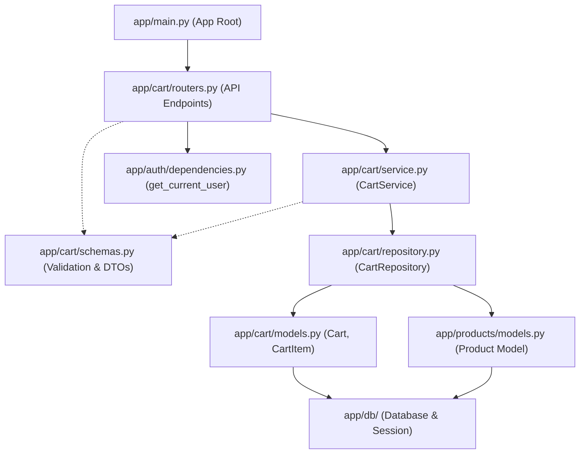

# Cart Feature API Guide

## Summary
The Cart feature manages customer shopping carts: viewing cart contents with calculated line-item subtotals and total amounts, adding products (with inventory stock validation and cumulative quantity handling), modifying item quantities, removing individual items, and emptying the entire cart.

All cart endpoints require authentication. The cart is bound to the currently authenticated user (`current_user.id`) and is automatically created if the user does not yet possess one.

Associated source files:
- Router: `app/cart/routers.py`
- Service: `app/cart/service.py`
- Repository: `app/cart/repository.py`
- Schemas: `app/cart/schemas.py`
- Models: `app/cart/models.py`
- Auth Dependency: `app/auth/dependencies.py`
- Product Model: `app/products/models.py`

---

## Schemas

### CartItemCreate
| Field | Type | Required | Rules | Description |
| :--- | :--- | :--- | :--- | :--- |
| `product_id` | integer | Yes | `>= 1` | ID of the product to add |
| `quantity` | integer | Yes | `>= 1` | Quantity of items to add |

### CartItemUpdate
| Field | Type | Required | Rules | Description |
| :--- | :--- | :--- | :--- | :--- |
| `quantity` | integer | Yes | `>= 1` | New absolute quantity for the cart item |

### CartItemResponse
| Field | Type | Description |
| :--- | :--- | :--- |
| `id` | integer | Unique cart item ID |
| `product_id` | integer | ID of the product |
| `product_name` | string | Product name |
| `unit_price` | number (Decimal) | Unit price of the product |
| `quantity` | integer | Current quantity in the cart |
| `subtotal` | number (Decimal) | Calculated subtotal (`unit_price * quantity`) |

### CartResponse
| Field | Type | Description |
| :--- | :--- | :--- |
| `id` | integer | Unique cart ID |
| `items` | array of CartItemResponse | List of items currently in the cart |
| `total` | number (Decimal) | Total cart value (sum of all item subtotals) |

---

## Models

### Cart
Mapped to table `carts`. Represents an authenticated user's active shopping cart session.

| Field | Type | Nullable | Constraints | Description |
| :--- | :--- | :--- | :--- | :--- |
| `id` | integer (`Integer`) | No | Primary Key, Indexed | Unique cart identifier |
| `user_id` | integer (`Integer`) | No | Foreign Key (`users.id`), Unique, Indexed | Reference to owner User ID |
| `created_at` | datetime (`DateTime(timezone=True)`) | No | Server default `func.now()` | Timestamp cart created (UTC) |
| `updated_at` | datetime (`DateTime(timezone=True)`) | No | Server default `func.now()`, auto-updated | Timestamp cart last updated (UTC) |

#### Relationships
| Field | Type | Cardinality | Back-populates | Description |
| :--- | :--- | :--- | :--- | :--- |
| `items` | `list[CartItem]` | One-to-Many | `cart` | Line items in cart (cascade: `all, delete-orphan`) |

### CartItem
Mapped to table `cart_items`. Represents individual product line items and quantities within a cart.

| Field | Type | Nullable | Constraints | Description |
| :--- | :--- | :--- | :--- | :--- |
| `id` | integer (`Integer`) | No | Primary Key, Indexed | Unique cart item identifier |
| `cart_id` | integer (`Integer`) | No | Foreign Key (`carts.id`, ondelete `CASCADE`), Indexed | Reference to parent Cart ID |
| `product_id` | integer (`Integer`) | No | Foreign Key (`products.id`), Indexed | Reference to associated Product ID |
| `quantity` | integer (`Integer`) | No | `>= 1` | Quantity of product added |

*Composite Unique Constraint*: `uq_cart_item_product` on `(cart_id, product_id)`.

#### Relationships
| Field | Type | Cardinality | Back-populates | Description |
| :--- | :--- | :--- | :--- | :--- |
| `cart` | `Cart` | Many-to-One | `items` | Parent Cart entity |
| `product` | `Product` | Many-to-One | — | Associated Product entity |

---

## Endpoints

### 1. Get Cart
Retrieves the current authenticated user's active shopping cart, including all items, computed subtotals, and overall cart total. Automatically initializes a new empty cart if one does not exist for the user.

- **Method**: `GET`
- **Path**: `/cart`
- **Status**: `200 OK` (or `401 Unauthorized`)

#### Headers
| Header | Value | Description |
| :--- | :--- | :--- |
| `Authorization` | `Bearer <access_token>` | Valid JWT access token |

#### Response Body
```json
{
  "id": 1,
  "items": [
    {
      "id": 1,
      "product_id": 10,
      "product_name": "Wireless Mouse",
      "unit_price": "29.99",
      "quantity": 2,
      "subtotal": "59.98"
    }
  ],
  "total": "59.98"
}
```

#### cURL Example
```bash
curl -X GET http://localhost:8000/cart \
  -H "Authorization: Bearer <access_token>"
```

---

### 2. Add Item to Cart
Adds a specified quantity of a product to the user's cart. If the product is already in the cart, its quantity is increased. Validates that the product exists, has available inventory, and the total requested quantity does not exceed the current stock.

- **Method**: `POST`
- **Path**: `/cart/items`
- **Status**: `200 OK` (or `401 Unauthorized`, `404 Not Found`, `409 Conflict`)

#### Headers
| Header | Value | Description |
| :--- | :--- | :--- |
| `Authorization` | `Bearer <access_token>` | Valid JWT access token |

#### Request Body
```json
{
  "product_id": 10,
  "quantity": 2
}
```

#### Response Body
```json
{
  "id": 1,
  "items": [
    {
      "id": 1,
      "product_id": 10,
      "product_name": "Wireless Mouse",
      "unit_price": "29.99",
      "quantity": 2,
      "subtotal": "59.98"
    }
  ],
  "total": "59.98"
}
```

#### cURL Example
```bash
curl -X POST http://localhost:8000/cart/items \
  -H "Authorization: Bearer <access_token>" \
  -H "Content-Type: application/json" \
  -d '{
    "product_id": 10,
    "quantity": 2
  }'
```

---

### 3. Update Cart Item Quantity
Updates the absolute quantity of an existing item in the user's cart. Validates that the cart item belongs to the user and that the new quantity does not exceed available product inventory.

- **Method**: `PUT`
- **Path**: `/cart/items/{item_id}`
- **Status**: `200 OK` (or `401 Unauthorized`, `404 Not Found`, `409 Conflict`)

#### Headers
| Header | Value | Description |
| :--- | :--- | :--- |
| `Authorization` | `Bearer <access_token>` | Valid JWT access token |

#### Request Body
```json
{
  "quantity": 5
}
```

#### Response Body
```json
{
  "id": 1,
  "items": [
    {
      "id": 1,
      "product_id": 10,
      "product_name": "Wireless Mouse",
      "unit_price": "29.99",
      "quantity": 5,
      "subtotal": "149.95"
    }
  ],
  "total": "149.95"
}
```

#### cURL Example
```bash
curl -X PUT http://localhost:8000/cart/items/1 \
  -H "Authorization: Bearer <access_token>" \
  -H "Content-Type: application/json" \
  -d '{
    "quantity": 5
  }'
```

---

### 4. Remove Item from Cart
Deletes a specific line item from the user's cart by item ID.

- **Method**: `DELETE`
- **Path**: `/cart/items/{item_id}`
- **Status**: `204 No Content` (or `401 Unauthorized`, `404 Not Found`)

#### Headers
| Header | Value | Description |
| :--- | :--- | :--- |
| `Authorization` | `Bearer <access_token>` | Valid JWT access token |

#### Response Body
*Empty body*

#### cURL Example
```bash
curl -i -X DELETE http://localhost:8000/cart/items/1 \
  -H "Authorization: Bearer <access_token>"
```

---

### 5. Clear Cart
Removes all items from the current user's cart, leaving an empty cart.

- **Method**: `DELETE`
- **Path**: `/cart`
- **Status**: `204 No Content` (or `401 Unauthorized`)

#### Headers
| Header | Value | Description |
| :--- | :--- | :--- |
| `Authorization` | `Bearer <access_token>` | Valid JWT access token |

#### Response Body
*Empty body*

#### cURL Example
```bash
curl -i -X DELETE http://localhost:8000/cart \
  -H "Authorization: Bearer <access_token>"
```

---

## Repository Capabilities

The `CartRepository` in `app/cart/repository.py` provides the following query and persistence operations:

- `get_cart_by_user_id(db, user_id)`: Fetches the user's cart with eager loading of `items` and linked `Product` data via `selectinload`.
- `create_cart(db, user_id)`: Creates and commits a new cart associated with a user ID.
- `get_product(db, product_id)`: Retrieves a product record to check price and stock levels.
- `get_item_by_product_id(db, cart_id, product_id)`: Finds an existing item matching a specific product within a cart.
- `get_item_by_id(db, cart_id, item_id)`: Finds a cart item by its primary key scoped to a specific cart.
- `create_item(db, cart_id, product_id, quantity)`: Inserts and refreshes a new cart item.
- `update_item_quantity(db, item, quantity)`: Updates the quantity of an existing item and commits.
- `delete_item(db, item)`: Deletes an individual cart item.
- `clear_items(db, cart_id)`: Performs a bulk delete of all items associated with a cart.

---

## File Association Flow



