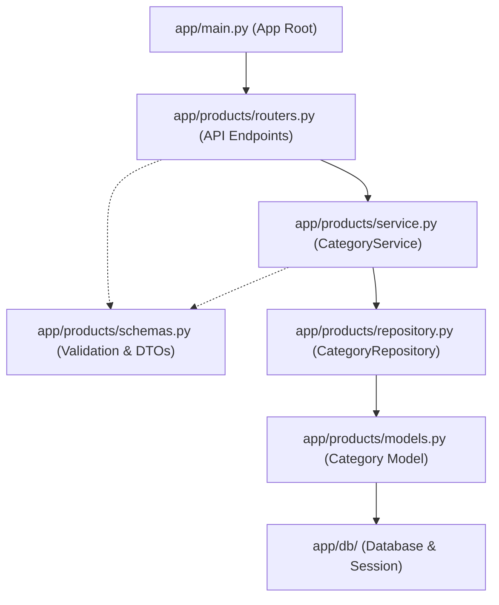

# Category Feature API Guide

## Summary
The Category feature organizes products into distinct catalog classifications. Each product links to a category via `category_id`.

Associated source files:
- Router: `app/products/routers.py`
- Service: `app/products/service.py`
- Repository: `app/products/repository.py`
- Schemas: `app/products/schemas.py`
- Models: `app/products/models.py`

---

## Schemas

### CategoryCreate
| Field | Type | Required | Rules | Description |
| :--- | :--- | :--- | :--- | :--- |
| `name` | string | Yes | 1-100 characters, unique | Name of the category |

### CategoryResponse
| Field | Type | Description |
| :--- | :--- | :--- |
| `id` | integer | Unique category ID |
| `name` | string | Category name |

---

## Models

### Category
Mapped to table `categories`. Represents product classifications in the catalog database.

| Field | Type | Nullable | Constraints | Description |
| :--- | :--- | :--- | :--- | :--- |
| `id` | integer (`Integer`) | No | Primary Key, Indexed | Unique category identifier |
| `name` | string (`String(100)`) | No | Unique, max 100 characters | Name of the category |

#### Relationships
| Field | Type | Cardinality | Back-populates | Description |
| :--- | :--- | :--- | :--- | :--- |
| `products` | `list[Product]` | One-to-Many | `category` | List of products belonging to this category |

### Product
Mapped to table `products`. Associated catalog item model defined in `app/products/models.py`.

| Field | Type | Nullable | Constraints | Description |
| :--- | :--- | :--- | :--- | :--- |
| `id` | integer (`Integer`) | No | Primary Key, Indexed | Unique product identifier |
| `name` | string (`String(200)`) | No | Indexed | Name of the product |
| `description` | string (`Text`) | Yes | null by default | Detailed description of the product |
| `price` | number (`Numeric(10, 2)`) | No | Precision 10, scale 2 | Unit price |
| `stock` | integer (`Integer`) | No | Default `0` | Available inventory count |
| `category_id` | integer (`Integer`) | No | Foreign Key (`categories.id`) | Reference to associated category |
| `image_url` | string (`String(500)`) | Yes | null by default, max 500 chars | URL link to product image |
| `created_at` | datetime (`DateTime`) | No | Default `datetime.utcnow` | Timestamp created (UTC) |
| `updated_at` | datetime (`DateTime`) | No | Default `datetime.utcnow`, auto-updated | Timestamp last updated (UTC) |

#### Relationships
| Field | Type | Cardinality | Back-populates | Description |
| :--- | :--- | :--- | :--- | :--- |
| `category` | `Category` | Many-to-One | `products` | Associated category entity |

---

## Endpoints

### 1. Create Category
Creates a new category record.

- **Method**: `POST`
- **Path**: `/products/create_category`
- **Status**: `201 Created`

#### Request Body
```json
{
  "name": "Electronics"
}
```

#### Response Body
```json
{
  "id": 1,
  "name": "Electronics"
}
```

#### cURL Example
```bash
curl -X POST http://localhost:8000/products/create_category \
  -H "Content-Type: application/json" \
  -d '{
    "name": "Electronics"
  }'
```

---

## Repository Capabilities

The `CategoryRepository` in `app/products/repository.py` already implements data operations ready for future endpoint additions:

- `create(db, category_data)`: Adds and returns a new category.
- `get_by_id(db, category_id)`: Fetches a category by its primary key.
- `delete(db, category)`: Removes a category entity.

---

## File Association Flow



