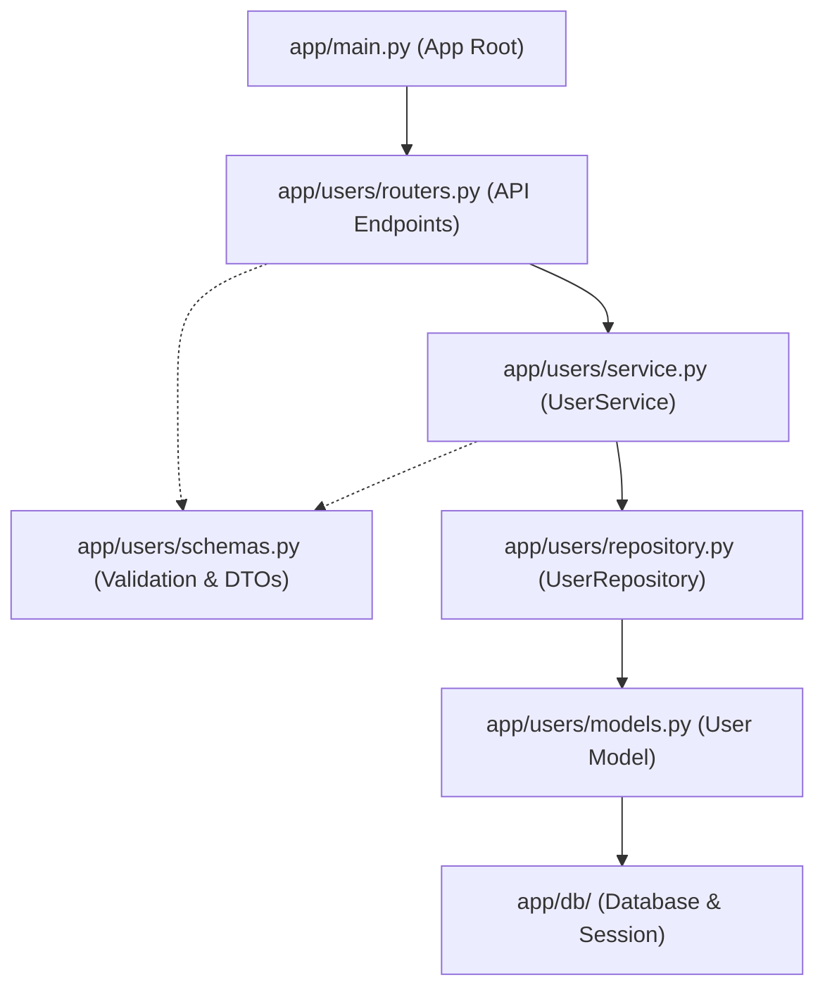

# User Feature API Guide

## Summary
The User feature manages user accounts within the platform: administrative user creation, listing users with pagination, retrieving user details by ID, updating user profiles, and removing user accounts.

Associated source files:
- Router: `app/users/routers.py`
- Service: `app/users/service.py`
- Repository: `app/users/repository.py`
- Schemas: `app/users/schemas.py`
- Models: `app/users/models.py`

---

## Schemas

### UserCreate
| Field | Type | Required | Rules | Description |
| :--- | :--- | :--- | :--- | :--- |
| `name` | string | Yes | Non-empty string | User's full name |
| `email` | string | Yes | Valid email format, unique | User's email address |
| `password` | string | Yes | 8-128 characters | User's account password |

### UserUpdate
All fields are optional. Only sent fields are updated.
| Field | Type | Required | Rules | Description |
| :--- | :--- | :--- | :--- | :--- |
| `name` | string | No | null by default | Updated full name |
| `email` | string | No | Valid email format, unique | Updated email address |

### UserResponse
| Field | Type | Description |
| :--- | :--- | :--- |
| `id` | integer | Unique user ID |
| `name` | string | User's full name |
| `email` | string | User's registered email |
| `role` | string | Assigned role (e.g. `"customer"`, `"admin"`) |
| `created_at` | datetime | Timestamp created (UTC) |
| `updated_at` | datetime | Timestamp last updated (UTC) |

---

## Models

### User
Mapped to table `users`. Represents user accounts and authentication credentials in the database.

| Field | Type | Nullable | Constraints | Description |
| :--- | :--- | :--- | :--- | :--- |
| `id` | integer (`Integer`) | No | Primary Key, Indexed | Unique user identifier |
| `name` | string (`String(100)`) | No | Max 100 characters | User's full name |
| `email` | string (`String(255)`) | No | Unique, Indexed, max 255 chars | User's registered email address |
| `password_hash` | string (`String(255)`) | No | Max 255 characters | Argon2 password hash (internal, never exposed via API) |
| `role` | string (`String(50)`) | No | Default `"customer"`, max 50 chars | Assigned authorization role (`"customer"` or `"admin"`) |
| `created_at` | datetime (`DateTime(timezone=True)`) | No | Server default `func.now()` | Timestamp when user registered (UTC) |
| `updated_at` | datetime (`DateTime(timezone=True)`) | No | Server default `func.now()`, auto-updated | Timestamp when user was last updated (UTC) |

---

## Endpoints

### 1. Create User
Creates a new user record directly in the system.

- **Method**: `POST`
- **Path**: `/users/`
- **Status**: `201 Created` (or `409 Conflict`, `422 Unprocessable Entity`)

#### Request Body
```json
{
  "name": "Jane Smith",
  "email": "jane.smith@example.com",
  "password": "SecurePassword123"
}
```

#### Response Body
```json
{
  "id": 2,
  "name": "Jane Smith",
  "email": "jane.smith@example.com",
  "role": "customer",
  "created_at": "2026-10-31T05:00:00Z",
  "updated_at": "2026-10-31T05:00:00Z"
}
```

#### cURL Example
```bash
curl -X POST http://localhost:8000/users/ \
  -H "Content-Type: application/json" \
  -d '{
    "name": "Jane Smith",
    "email": "jane.smith@example.com",
    "password": "SecurePassword123"
  }'
```

---

### 2. List Users
Returns a paginated list of all users in the system.

- **Method**: `GET`
- **Path**: `/users/`
- **Status**: `200 OK`

#### Query Parameters
| Parameter | Type | Default | Description |
| :--- | :--- | :--- | :--- |
| `skip` | integer | `0` | Number of records to skip (`>= 0`) |
| `limit` | integer | `100` | Maximum number of records to return (`1 - 100`) |

#### Response Body
```json
[
  {
    "id": 1,
    "name": "John Doe",
    "email": "john.doe@example.com",
    "role": "customer",
    "created_at": "2026-10-31T05:00:00Z",
    "updated_at": "2026-10-31T05:00:00Z"
  },
  {
    "id": 2,
    "name": "Jane Smith",
    "email": "jane.smith@example.com",
    "role": "customer",
    "created_at": "2026-10-31T05:00:00Z",
    "updated_at": "2026-10-31T05:00:00Z"
  }
]
```

#### cURL Example
```bash
# Default list (first 100 users)
curl -X GET "http://localhost:8000/users/"

# Paginated list
curl -X GET "http://localhost:8000/users/?skip=20&limit=10"
```

---

### 3. Get User by ID
Retrieves profile details for a specific user by primary key ID.

- **Method**: `GET`
- **Path**: `/users/{user_id}`
- **Status**: `200 OK` (or `404 Not Found`)

#### Response Body
```json
{
  "id": 1,
  "name": "John Doe",
  "email": "john.doe@example.com",
  "role": "customer",
  "created_at": "2026-10-31T05:00:00Z",
  "updated_at": "2026-10-31T05:00:00Z"
}
```

#### cURL Example
```bash
curl -X GET http://localhost:8000/users/1
```

---

### 4. Update User
Updates one or more fields of an existing user account. Validates email uniqueness if a new email address is provided.

- **Method**: `PUT`
- **Path**: `/users/{user_id}`
- **Status**: `200 OK` (or `404 Not Found`, `409 Conflict`)

#### Request Body
```json
{
  "name": "Johnathan Doe",
  "email": "johnathan.doe@example.com"
}
```

#### Response Body
```json
{
  "id": 1,
  "name": "Johnathan Doe",
  "email": "johnathan.doe@example.com",
  "role": "customer",
  "created_at": "2026-10-31T05:00:00Z",
  "updated_at": "2026-10-31T05:30:00Z"
}
```

#### cURL Example
```bash
curl -X PUT http://localhost:8000/users/1 \
  -H "Content-Type: application/json" \
  -d '{
    "name": "Johnathan Doe",
    "email": "johnathan.doe@example.com"
  }'
```

---

### 5. Delete User
Permanently deletes a user account from the system.

- **Method**: `DELETE`
- **Path**: `/users/{user_id}`
- **Status**: `204 No Content` (or `404 Not Found`)

#### Response Body
*Empty body*

#### cURL Example
```bash
curl -i -X DELETE http://localhost:8000/users/1
```

---

## Repository Capabilities

The `UserRepository` in `app/users/repository.py` implements the persistence layer operations:

- `create(db, user)`: Adds and returns a new user record.
- `get_by_id(db, user_id)`: Fetches a single user by primary key ID.
- `get_by_email(db, email)`: Fetches a user by unique email address.
- `get_all(db, skip, limit)`: Queries users with pagination offset and limit.
- `update(db, user)`: Commits updates and refreshes the user record.
- `delete(db, user)`: Removes a user entity from the database.

---

## File Association Flow



