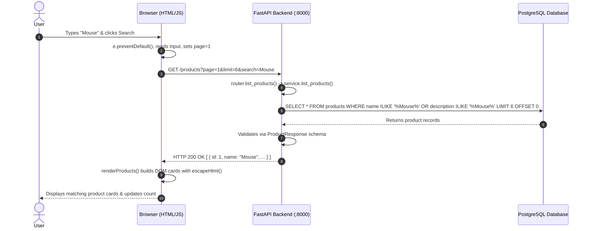
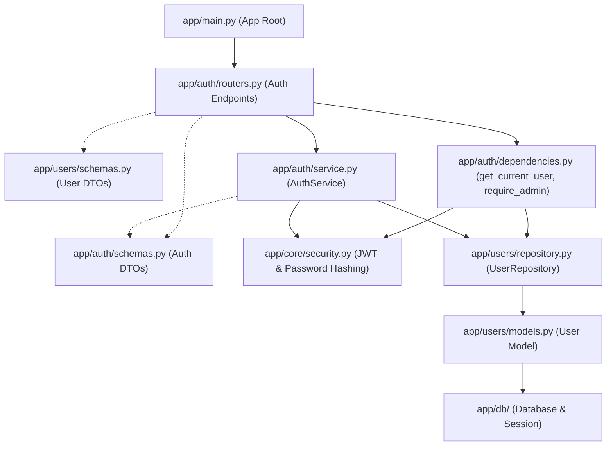
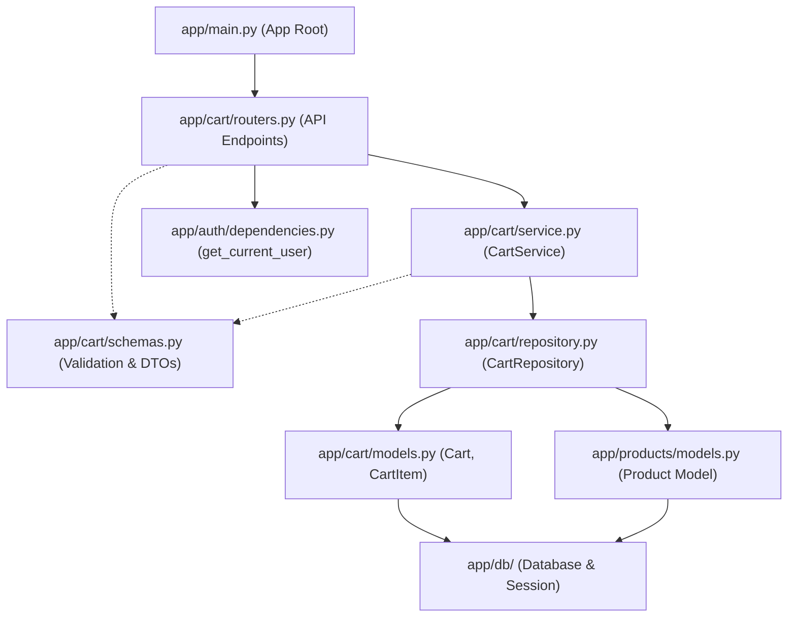
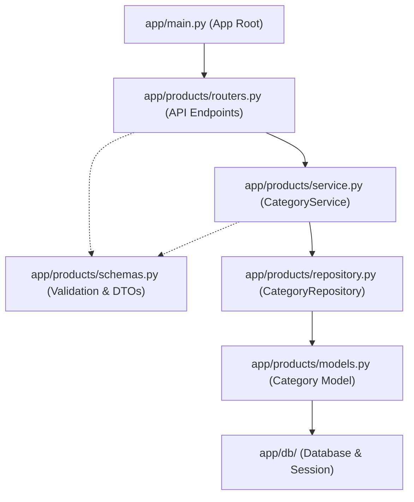
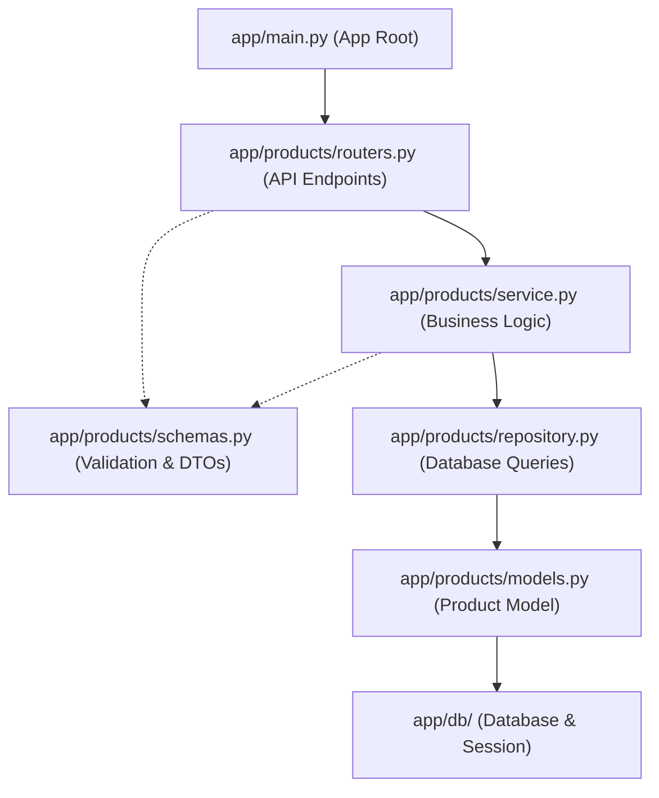
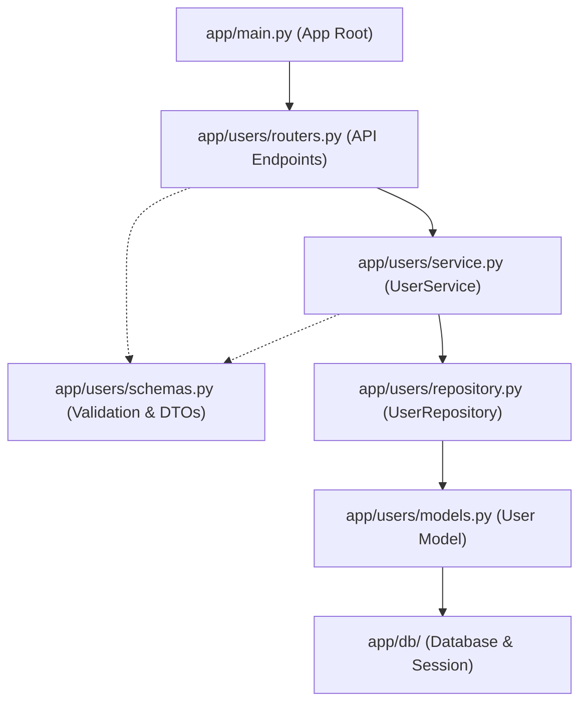

# Complete Backend Guide

## Guide Directory Tree

```text
guide/
├── complete_guide.md
├── architecture/
│   ├── architecture.md
│   ├── phase_1_completed.md
│   └── phase_2_roadmap.md
├── structure/
│   └── directory_tree.md
└── api_guide/
    ├── auth.md
    ├── cart.md
    ├── category.md
    ├── products.md
    └── users.md
```

## Table of Contents
- [Architecture](#architecture)
  - [architecture.md](#architecturemd)
  - [phase_1_completed.md](#phase_1_completedmd)
  - [phase_2_roadmap.md](#phase_2_roadmapmd)
- [Structure](#structure)
  - [directory_tree.md](#directory_treemd)
- [API Guide](#api-guide)
  - [auth.md](#authmd)
  - [cart.md](#cartmd)
  - [category.md](#categorymd)
  - [products.md](#productsmd)
  - [users.md](#usersmd)

---

# Architecture

---

## architecture.md

# E-Commerce Web Development Project

A project-based approach to learning modern web development by building an e-commerce application from the ground up.

The goal is **not just to build an e-commerce site**, but to understand how a real web application works from browser to backend to database.

---

## 1. Project Goal

Build a modular e-commerce web application in multiple phases.

The project will start simple and gradually introduce more advanced concepts.

### Main learning approach

Since backend development is already more familiar:

```
Phase
  │
  ├── Backend
  │
  ├── Frontend
  │
  └── Integration
```

We will first build the backend for a phase, then build its frontend, and finally connect and test everything together.

This allows backend concepts to remain familiar while learning frontend development gradually.

---

# 2. Architecture Philosophy

The project will initially use a **Modular Monolith** architecture.

The application will be one deployable backend application, but internally divided into independent feature modules.

```
                    E-Commerce Application
                             │
              ┌──────────────┴──────────────┐
              │                             │
           Frontend                       Backend
              │                             │
              │                  ┌──────────┼──────────┐
              │                  │          │          │
              │              Products     Users      Orders
              │                  │          │          │
              │                  └──────────┼──────────┘
              │                             │
              │                        PostgreSQL
              │
              └──────────── HTTP / API ─────┘
```

### Why modular?

As the application grows, new features can be added as separate modules:

```
products/
users/
cart/
orders/
payments/
reviews/
coupons/
notifications/
```

This avoids turning the project into one large, difficult-to-maintain codebase.

We will **not** start with microservices.

If the application eventually becomes large enough to justify separate services, individual modules can be extracted later.

---

# 3. Phase 1 — Product Store

## Goal

Build the basic store experience.

A visitor should be able to browse and search products.

An administrator should be able to manage products.

### User flow

```
Home
  │
  ▼
Product Listing
  │
  ├── Search
  ├── Filter
  └── Pagination
  │
  ▼
Product Details
```

### Admin flow

```
Admin
  │
  ▼
Product Management
  │
  ├── Create Product
  ├── View Products
  ├── Update Product
  └── Delete Product
```

---

## Phase 1 Features

### Product Catalog

- Product listing
- Product details
- Product name
- Description
- Price
- Stock quantity
- Product image
- Category
- Creation/update timestamps

### Product Search

Basic search by:

- Product name
- Description

### Product Filtering

Initially:

- Category
- Price range

Additional filters can be added later.

### Pagination

Product lists should not return every product at once.

Example:

```
/products?page=1&limit=20
```

### Product Management

Admin functionality:

```
POST    /products
GET     /products
GET     /products/{id}
PUT     /products/{id}
DELETE  /products/{id}
```

---

# 4. Phase 1 Architecture

```
                        Browser
                           │
                           │ HTTP
                           ▼
                      FastAPI API
                           │
                  ┌────────┴────────┐
                  │                 │
             Product Module      Other Core
                  │
                  ▼
              PostgreSQL
```

### Phase 1 backend

Conceptually:

```
backend/
└── app/
    ├── main.py
    │
    ├── core/
    │
    ├── db/
    │
    ├── d/
    │   ├── models.py
    │   ├── schemas.py
    │   ├── router.py
    │   └── service.py
    │
    └── ...
```

The exact structure will be introduced gradually during implementation rather than creating everything at once.

---

# 5. Phase 1 Development Sequence

## Phase 1A — Backend

### Step 1 — Project setup

Learn/setup:

- Python environment
- FastAPI
- project configuration
- environment variables
- Git

### Step 2 — Database

Set up:

- PostgreSQL
- SQLAlchemy
- Alembic

Learn:

- tables
- primary keys
- foreign keys
- basic relationships
- migrations

### Step 3 — Product module

Create:

```
Product
```

with fields such as:

```
id
name
description
price
stock
category_id
image_url
created_at
updated_at
```

### Step 4 — CRUD API

Implement:

```
Create
Read
Update
Delete
```

### Step 5 — Search/filter/pagination

Add:

```
search
filter
pagination
```

### Step 6 — Backend testing

Test:

- API endpoints
- validation
- database operations
- common error cases

---

# 6. Phase 1B — Frontend

The first frontend will use:

```
HTML
CSS
JavaScript
```

We will intentionally avoid React at this stage.

### Pages

```
/
├── Home
│
├── /products
│   └── Product listing
│
├── /products/{id}
│   └── Product details
│
└── /admin
    └── Product management
```

### Frontend concepts learned

- HTML structure
- CSS layout
- Flexbox
- CSS Grid
- responsive design
- JavaScript
- DOM manipulation
- browser events
- forms
- Fetch API
- JSON
- API integration
- browser DevTools

---

# 7. Phase 1C — Integration

Connect:

```
Frontend
    │
    │ fetch()
    ▼
FastAPI
    │
    ▼
PostgreSQL
```

Example:

```
User opens Products page
        ↓
JavaScript requests /products
        ↓
FastAPI receives request
        ↓
Database query
        ↓
FastAPI returns JSON
        ↓
JavaScript receives JSON
        ↓
Products rendered in browser
```

### Phase 1 completion criteria

Phase 1 is complete when:

- Products can be stored in PostgreSQL
- Products can be managed through the API
- Products can be viewed from the frontend
- Search works
- Filtering works
- Pagination works
- Basic admin product management works
- Frontend and backend communicate correctly

---

# 8. Phase 2 — Real E-Commerce

## Goal

Turn the product store into an actual e-commerce application.

Phase 2 introduces users, authentication, shopping carts, checkout, and orders.

### Main user flow

```
Register / Login
       │
       ▼
Browse Products
       │
       ▼
Product Details
       │
       ▼
Add to Cart
       │
       ▼
Cart
       │
       ▼
Checkout
       │
       ▼
Create Order
       │
       ▼
Order Confirmation
       │
       ▼
My Orders
```

---

# 9. Phase 2 Features

## Authentication

Users can:

- Register
- Login
- Logout
- View their profile

Learn:

- password hashing
- authentication
- authorization
- sessions/tokens
- protected endpoints

---

## User Roles

Initially:

```
Customer
Admin
```

### Customer

Can:

- Browse products
- Manage cart
- Checkout
- View own orders
- Manage profile

### Admin

Can:

- Manage products
- View orders
- Update order status

---

## Shopping Cart

Users can:

- Add products
- Remove products
- Change quantity
- View cart
- See cart total

Example:

```
Cart
──────────────────────
Product       Qty  Price
──────────────────────
Shoes          2    $100
T-Shirt        1     $30
──────────────────────
Total                $130
```

---

## Checkout

Initial checkout:

```
Cart
 ↓
Shipping information
 ↓
Order summary
 ↓
Place order
 ↓
Order created
```

Real payment processing will **not** be introduced initially.

Payment can be simulated first.

---

## Orders

Users can:

- Create an order
- View their orders
- View order details

Admins can:

- View orders
- Update order status

Example statuses:

```
pending
confirmed
processing
shipped
delivered
cancelled
```

---

# 10. Phase 2 Architecture

The backend grows by adding modules rather than restructuring the whole application.

```
backend/
└── app/
    │
    ├── core/
    │
    ├── db/
    │
    ├── products/
    │
    ├── users/
    │
    ├── auth/
    │
    ├── cart/
    │
    └── orders/
    │
    └── main.py
```

Conceptually:

```
                         FastAPI
                            │
       ┌────────────────────┼────────────────────┐
       │                    │                    │
   Products              Users/Auth            Orders
       │                    │                    │
       │                    │                    │
       └────────────────────┼────────────────────┘
                            │
                           Cart
                            │
                            ▼
                       PostgreSQL
```

---

# 11. Phase 2 Development Sequence

## Phase 2A — Backend

Build in this order:

```
1. Users
      ↓
2. Authentication
      ↓
3. Authorization / Roles
      ↓
4. Cart
      ↓
5. Orders
      ↓
6. Checkout
```

This order is intentional.

Orders depend on users and products.

Cart depends on users and products.

Checkout depends on cart and orders.

---

## Phase 2B — Frontend

Build:

```
Login
Register
   ↓
Product Store
   ↓
Product Details
   ↓
Cart
   ↓
Checkout
   ↓
Order Confirmation
   ↓
My Orders
```

Admin:

```
Admin Dashboard
   ├── Products
   └── Orders
```

---

## Phase 2C — Integration

Connect all components:

```
Browser
   │
   ▼
Frontend
   │
   ▼
FastAPI
   │
   ├── Users
   ├── Products
   ├── Cart
   └── Orders
   │
   ▼
PostgreSQL
```

---

# 12. Final Phase 1 + Phase 2 Architecture

At the end of Phase 2, the application should roughly look like:

```
                         E-COMMERCE
                              │
              ┌───────────────┴───────────────┐
              │                               │
           Frontend                         Backend
              │                               │
       HTML/CSS/JavaScript              FastAPI
              │                               │
              │                    ┌──────────┼──────────┐
              │                    │          │          │
              │                Products     Users      Orders
              │                               │          │
              │                              Auth       Cart
              │                    │          │          │
              │                    └──────────┼──────────┘
              │                               │
              └──────────── API ──────────────┘
                                              │
                                              ▼
                                         PostgreSQL
```

This is still one application, but internally modular.

---

# 13. Project Structure

The structure will evolve with the phases.

## Starting structure

```
ecommerce/
│
├── backend/
│   ├── app/
│   │   ├── main.py
│   │   ├── core/
│   │   ├── db/
│   │   └── products/
│   │
│   └── tests/
│
├── frontend/
│
├── .env
├── .gitignore
└── README.md
```

## After Phase 2

```
ecommerce/
│
├── backend/
│   │
│   ├── app/
│   │   │
│   │   ├── main.py
│   │   │
│   │   ├── core/
│   │   │
│   │   ├── db/
│   │   │
│   │   ├── products/
│   │   │
│   │   ├── users/
│   │   │
│   │   ├── auth/
│   │   │
│   │   ├── cart/
│   │   │
│   │   └── orders/
│   │
│   └── tests/
│
├── frontend/
│   │
│   ├── pages/
│   ├── components/
│   ├── css/
│   └── js/
│
├── .env
├── .gitignore
└── README.md
```

The exact frontend structure may change when React is introduced.

---

# 14. Initial Technology Stack

Keep the initial stack small.

## Backend

| Technology | Purpose |
| --- | --- |
| Python | Backend language |
| FastAPI | API framework |
| SQLAlchemy | Database ORM |
| PostgreSQL | Relational database |
| Alembic | Database migrations |
| Pydantic | Data validation |

---

## Frontend

Initially:

| Technology | Purpose |
| --- | --- |
| HTML | Page structure |
| CSS | Styling/layout |
| JavaScript | Interactivity |
| Fetch API | Backend communication |

Later:

```
React
```

will be introduced after the fundamentals are understood.

---

## Development Tools

| Tool | Purpose |
| --- | --- |
| VS Code | Development |
| Git | Version control |
| GitHub | Repository |
| PostgreSQL | Local database |
| Postman/Insomnia | API testing |
| Browser DevTools | Frontend/debugging |

---

## DevOps — Initially

Only learn the essentials:

```
Git
Environment variables
Basic Docker
Docker Compose
```

Docker should be introduced after the basic application is working locally.

Later, when the project is ready for deployment:

```
Docker
CI/CD
HTTPS
Reverse Proxy
Cloud Deployment
Logging
Monitoring
```

---

# 15. Things We Will Deliberately NOT Use Initially

Avoid unnecessary complexity.

We will not start with:

```
Microservices
Kubernetes
Redis
Message queues
Event-driven architecture
Complex caching
GraphQL
Advanced CI/CD
Real payment integration
Recommendation systems
```

These may become useful later, but they are not necessary for learning the fundamentals or building the first version.

---

# 16. Development Rules

### Rule 1 — Learn while building

Do not try to learn the entire frontend ecosystem before writing the application.

Learn a concept when the project needs it.

---

### Rule 2 — Backend first

For each phase:

```
Backend
   ↓
Frontend
   ↓
Integration
```

This matches the development approach of the project.

---

### Rule 3 — Build small increments

Don't build an entire phase before running the application.

Instead:

```
Product model
   ↓
Run/test
   ↓
Product API
   ↓
Run/test
   ↓
Product page
   ↓
Run/test
```

---

### Rule 4 — Prefer simple architecture

Use the simplest design that solves the current problem.

Don't create abstractions for features that don't exist yet.

---

### Rule 5 — Keep modules independent

When adding a feature, ask:

> "Can this functionality live inside its own module?"
> 

For example:

```
products/
cart/
orders/
```

rather than putting everything into a generic `utils` or `services` folder.

---

# 17. Learning Progression

The project should gradually teach the following concepts.

```
PHASE 1
────────

Web fundamentals
      ↓
HTML
      ↓
CSS
      ↓
JavaScript
      ↓
HTTP / APIs
      ↓
FastAPI
      ↓
PostgreSQL
      ↓
SQLAlchemy
      ↓
CRUD
      ↓
Search / Filter / Pagination
      ↓
Frontend ↔ Backend
```

Then:

```
PHASE 2
────────

Authentication
      ↓
Authorization
      ↓
Users
      ↓
Frontend state
      ↓
Cart
      ↓
Database relationships
      ↓
Orders
      ↓
Transactions
      ↓
Checkout
```

Later phases can introduce:

```
React
Testing
Docker
Deployment
Payments
Caching
Background tasks
Advanced security
CI/CD
```

---

# 18. Definition of Success

The project is successful if, by the end, you can look at the application and understand:

```
What happens when a user clicks a button?
            ↓
How does JavaScript handle it?
            ↓
How does it make an HTTP request?
            ↓
How does FastAPI receive it?
            ↓
How does the backend process it?
            ↓
How does it communicate with PostgreSQL?
            ↓
How does the response return?
            ↓
How does the browser update?
```

The purpose of this project is therefore not simply:

> "Build an e-commerce website."
> 

It is:

> **Learn how modern web applications are designed, built, connected, and eventually deployed by building one real application incrementally.**
>

---

## phase_1_completed.md

# End-to-End Project Summary & Completed Milestones

This document provides a comprehensive, end-to-end record of everything designed, built, integrated, and verified in the E-Commerce application so far.

---

## Table of Contents

1. [High-Level Architecture & Philosophy](#1-high-level-architecture--philosophy)
2. [Project Setup & Environment](#2-project-setup--environment)
3. [Database & Migrations Layer](#3-database--migrations-layer)
4. [Backend: Product Module (4-Layer Pattern)](#4-backend-product-module-4-layer-pattern)
5. [Backend: FastAPI Application & Middleware](#5-backend-fastapi-application--middleware)
6. [Frontend: UI, Design System & DOM Manipulation](#6-frontend-ui-design-system--dom-manipulation)
7. [Frontend: JavaScript Client Logic & State](#7-frontend-javascript-client-logic--state)
8. [End-to-End Integration Flow](#8-end-to-end-integration-flow)
9. [Documentation & API Reference Completed](#9-documentation--api-reference-completed)
10. [Current Project Structure](#10-current-project-structure)
11. [What Comes Next (Phase 2 Roadmap)](#11-what-comes-next-phase-2-roadmap)

---

## 1. High-Level Architecture & Philosophy

The project follows a **Modular Monolith** architecture:
* **One Deployable Application**: Avoids the premature overhead of microservices, service meshes, and distributed tracing.
* **Domain-Driven Feature Modules**: The backend is organized by discrete domain features (`products`, and upcoming `users`, `auth`, `cart`, `orders`).
* **Backend-First Incremental Approach**:
  1. Define database schema & migrations.
  2. Implement repository, business logic service, and API routers.
  3. Validate endpoints with Swagger docs and cURL.
  4. Build pure HTML/CSS/JS frontend to consume the API.
  5. Connect and verify the full round-trip flow from browser to database.

```
                    E-Commerce Application
                             │
              ┌──────────────┴──────────────┐
              │                             │
           Frontend                       Backend
       (HTML / CSS / JS)                  (FastAPI)
              │                             │
              │                  ┌──────────┼──────────┐
              │                  │          │          │
              │              Products     Users      Orders
              │                  │          │          │
              │                  └──────────┼──────────┘
              │                             │
              │                        PostgreSQL
              │                             │
              └──────────── HTTP / API ─────┘
```

---

## 2. Project Setup & Environment

* **Python Runtime**: Python `>= 3.12`.
* **Package Management**: Managed with `pyproject.toml` and modern dependency locking via `uv`.
* **Dependencies**:
  * `fastapi`: Modern, high-performance web framework.
  * `uvicorn`: ASGI server for running the FastAPI application.
  * `sqlalchemy`: Next-gen ORM with 2.0 typed mappings.
  * `alembic`: Database migrations tool.
  * `pydantic-settings`: Type-safe configuration management from `.env`.
  * `psycopg2-binary`: PostgreSQL database adapter.
* **Configuration Layer (`app/core/config.py`)**:
  * Loads `DATABASE_URL` safely using Pydantic's `BaseSettings`.
  * Supports `.env` and fallback `.env.example`.

---

## 3. Database & Migrations Layer

### Database Setup (`app/db/`)
* **`app/db/base.py`**: Declarative base class (`Base = DeclarativeBase`) for all SQLAlchemy models.
* **`app/db/sessions.py`**:
  * Creates the SQLAlchemy engine with `settings.DATABASE_URL` (with `echo=True` for query inspection).
  * Defines `SessionLocal` factory (`autocommit=False, autoflush=False`).
  * Implements `get_db()` dependency injection generator ensuring sessions are always closed after request completion (`try ... finally: db.close()`).

### Relational Schema (`app/products/models.py`)
Utilizes SQLAlchemy 2.0 type annotations (`Mapped`, `mapped_column`, `relationship`):

1. **`categories` Table**:
   * `id`: Integer, primary key, indexed.
   * `name`: String(100), unique, non-nullable.
   * Relationship: Bidirectional 1-to-many relationship with `Product`.

2. **`products` Table**:
   * `id`: Integer, primary key, indexed.
   * `name`: String(200), non-nullable, indexed for search.
   * `description`: Text, nullable.
   * `price`: Numeric(10, 2), non-nullable.
   * `stock`: Integer, non-nullable, default `0`.
   * `category_id`: Foreign key referencing `categories.id`, non-nullable.
   * `image_url`: String(500), nullable.
   * `created_at`: DateTime UTC timestamp, non-nullable.
   * `updated_at`: DateTime UTC timestamp, auto-updated on change.
   * Relationship: Foreign key link back to `Category`.

### Alembic Migrations (`backend/alembic/`)
* Configured `env.py` to bind to `settings.DATABASE_URL` and register `Base.metadata`.
* Created and executed initial migration:
  * `f165da70bd0c_create_products_and_categories.py`: Provisions `categories` and `products` tables with foreign keys and indexes.

---

## 4. Backend: Product Module (4-Layer Pattern)

The `products` module adheres strictly to clean code separation of concerns:

```
Request ──▶ Router ──▶ Service ──▶ Repository ──▶ Database
               │           │             │
               ▼           ▼             ▼
            Schemas     Schemas        Models
```

### Layer 1: Pydantic Validation & Serialization Schemas (`app/products/schemas.py`)
* **Category**:
  * `CategoryCreate`: Validates category name (1-100 characters).
  * `CategoryResponse`: Serializes category entity including `id`.
* **Product**:
  * `ProductCreate`: Validates required fields (`name`, `price > 0`, `stock >= 0`, `category_id`).
  * `ProductUpdate`: Allows partial updates (all fields optional with validation constraints).
  * `ProductResponse`: Complete product payload with formatted price, timestamps, and ORM conversion (`from_attributes = True`).

### Layer 2: Repository Data Access (`app/products/repository.py`)
Encapsulates all direct database SQL queries using SQLAlchemy 2.0 `select()` statements:
* **`ProductRepository`**:
  * `create(db, product_data)`: Adds and commits a new product.
  * `get_by_id(db, product_id)`: Retrieves single product by primary key.
  * `get_all(db, skip, limit)`: Paginated fetch.
  * `delete(db, product)`: Deletes product entity from the session.
* **`CategoryRepository`**:
  * `create(db, category_data)`: Creates category.
  * `get_by_id(db, category_id)`: Fetches category.
  * `delete(db, category)`: Deletes category.

### Layer 3: Service Business Logic (`app/products/service.py`)
Orchestrates business workflows, input filtering, and HTTP exception handling:
* **`ProductService`**:
  * `create_product`: Validates foreign key presence and delegates creation.
  * `get_product`: Retrieves product or raises `HTTPException(404, "Product not found")`.
  * `list_products`: Dynamic query building:
    * Supports case-insensitive `ILIKE` search across both product `name` and `description`.
    * Filters by `category_id`.
    * Filters by price range (`min_price`, `max_price`).
    * Handles pagination offsets: `offset = (page - 1) * limit`.
  * `update_product`: Executes partial updates via `model_dump(exclude_unset=True)` and refreshes entity.
  * `delete_product`: Verifies existence and removes product.
* **`CategoryService`**:
  * `create_category`: Manages category creation.

### Layer 4: API Router Endpoints (`app/products/routers.py`)
Exposes RESTful endpoints under `/products`:

| Method | Endpoint | Status | Description |
| :--- | :--- | :--- | :--- |
| `POST` | `/products` | `201 Created` | Create a new product |
| `GET` | `/products` | `200 OK` | List products with pagination, search & filters |
| `GET` | `/products/{id}` | `200 OK` | Fetch product details by ID |
| `PUT` | `/products/{id}` | `200 OK` | Update product details |
| `DELETE` | `/products/{id}` | `204 No Content` | Delete a product |
| `POST` | `/products/create_category` | `201 Created` | Create a new category |

---

## 5. Backend: FastAPI Application & Middleware

In `app/main.py`:
* Initialized FastAPI application with metadata:
  ```python
  app = FastAPI(title="E-Commerce API", version="0.1.0")
  ```
* **CORS Middleware**: Configured `CORSMiddleware` to allow cross-origin requests from the frontend:
  * Allowed origins: `http://localhost:5500`, `http://127.0.0.1:5500`, and `3000`.
  * Allowed methods: `*` (GET, POST, PUT, DELETE, etc.).
  * Allowed headers: `*`.
* **Health Check**: `GET /health` returning `{"status": "ok"}`.
* **Router Inclusion**: Attached `product_router` with prefix `/products`.

---

## 6. Frontend: UI, Design System & DOM Manipulation

Built using pure **HTML5** and **Vanilla CSS** without framework overhead:

### Semantic HTML Layout (`frontend/index.html`)
1. **Navigation Bar (`.navbar`)**:
   * Brand title and icon.
   * Navigation links (`Products`, `Admin`).
   * User badge, **Cart Button** with badge counter (`Cart (0)`), and **Login Button**.
2. **Hero Banner (`.hero-banner`)**:
   * Catchy headline and description.
   * Anchor button `<a href="#products-section" class="btn btn-primary shop-now-btn">Shop Now</a>` linking smoothly down to the product catalog.
3. **Main Layout (`.layout-wrapper`)**:
   * **Sidebar (`.sidebar`)**:
     * Search form (`#searchForm`) with text input and submit button.
     * Category radio buttons (`All Products`, `Electronics`, `Clothing`).
     * "Clear Filters" button (`#clearFiltersBtn`).
   * **Products Grid (`#productsGrid`)**:
     * Responsive CSS grid where product cards are dynamically injected by JavaScript.
     * Product count indicator (`#productCount`).
   * **Pagination Section (`.pagination`)**:
     * Previous button (`#prevBtn`), Page indicator (`#pageIndicator`), and Next button (`#nextBtn`).
4. **Footer (`.footer`)**:
   * Site links and copyright notice.

### CSS Styling & Design Tokens (`frontend/css/style.css`)
* **Custom Properties / Design Tokens**: Modern color palette (`--primary: #2563eb`, `--success: #16a34a`, neutral grays, shadows, border radii).
* **Grid & Flexbox**: Auto-fit product grid (`grid-template-columns: repeat(auto-fill, minmax(260px, 1fr))`).
* **Smooth Scrolling**: Global `scroll-behavior: smooth;` for in-page navigation.
* **Component Styling**:
  * Product cards with image thumbnails, price formatting, stock status pills (`In Stock` / `Out of Stock`).
  * Interactive button states (hover effects, active transforms, disabled styling).

---

## 7. Frontend: JavaScript Client Logic & State

Located in `frontend/js/app.js`:

### 1. State Management
```javascript
const API_BASE_URL = "http://localhost:8000";
const PAGE_LIMIT = 6;

let currentPage = 1;
let selectedCategory = "";
let searchQuery = "";
let cartCount = 0;
```

### 2. Core Functions
* **`fetchProducts()`**:
  * Renders a loading state placeholder in `#productsGrid`.
  * Constructs query parameters dynamically using `URLSearchParams` (`page`, `limit`, `category_id`, `search`).
  * Calls backend API: `GET http://localhost:8000/products?...`
  * Passes JSON payload to `renderProducts()`.
  * Updates pagination state.
  * Handles connection errors gracefully with user-friendly retry guidance.
* **`renderProducts(products)`**:
  * Empties the grid container.
  * Handles empty search results (`"🔍 No products found matching your criteria"`).
  * Generates product card elements dynamically.
  * Employs `escapeHtml()` utility to prevent Cross-Site Scripting (XSS).
  * Safely handles image load errors with fallback icons.
  * Attaches event listeners to each card's "Add to Cart" button.
* **`handleAddToCart(product, button)`**:
  * Increments cart count and updates header badge (`Cart (N)`).
  * Provides visual button confirmation (`✓ Added!` with green highlight) using a temporary `setTimeout`.
* **`updatePagination(itemsReceived)`**:
  * Updates `Page X` indicator.
  * Disables "Previous" on page 1.
  * Disables "Next" when fewer items than `PAGE_LIMIT` are returned.

### 3. User Interactions & Event Handlers
* **Search Form Submission**: Prevents reload via `e.preventDefault()`, captures trimmed query, resets page to 1, and fetches filtered products.
* **Category Radio Selection**: Updates `selectedCategory`, resets page to 1, and refetches catalog.
* **Clear Filters Button**: Clears search text, checks "All Products" radio, resets internal state, and reloads full catalog.
* **Pagination (Next/Prev)**: Increments/decrements page counter and triggers `fetchProducts()`.
* **Cart Button**: Alerts user with current cart count.
* **Initial Page Load**: Triggers `fetchProducts()` upon `DOMContentLoaded`.
* **Cache Management**: Added script versioning (`<script src="js/app.js?v=2"></script>`) to prevent stale browser caching during development.

---

## 8. End-to-End Integration Flow

Here is how data flows through the entire system during a typical user action:



---

## 9. Documentation & API Reference Completed

In `backend/guide/`:
* **`product_structure/architecture.md`**: Master blueprint detailing Phase 1 (Product Store) through Phase 2 (Real E-Commerce), development rules, and technology roadmaps.
* **`api_guide/products.md`**: Complete REST API specification for products, covering schemas, rules, endpoints, status codes, and sample cURL requests.
* **`api_guide/category.md`**: Complete category API specification, schemas, repository methods, and Mermaid sequence flows.

---

## 10. Current Project Structure

```
ecommerce/
├── .env.example                               # Sample environment variables
├── .gitignore                                 # Git ignore rules
├── README.md                                  # Repository overview
│
├── backend/
│   ├── pyproject.toml                         # Project metadata & dependencies
│   ├── uv.lock                                # Pinned dependency lockfile
│   ├── alembic.ini                            # Alembic configuration
│   │
│   ├── alembic/
│   │   ├── env.py                             # Alembic runtime environment
│   │   └── versions/
│   │       └── f165da70bd0c_create_products_and_categories.py
│   │
│   ├── app/
│   │   ├── main.py                            # FastAPI app root & CORS
│   │   ├── core/
│   │   │   └── config.py                      # Pydantic BaseSettings
│   │   ├── db/
│   │   │   ├── base.py                        # Declarative Base
│   │   │   └── sessions.py                    # Engine & get_db dependency
│   │   └── products/
│   │       ├── models.py                      # SQLAlchemy Product & Category models
│   │       ├── schemas.py                     # Pydantic validation schemas
│   │       ├── repository.py                  # Database queries
│   │       ├── service.py                     # Business logic & filtering
│   │       └── routers.py                     # REST endpoints
│   │
│   └── guide/
│       ├── api_guide/
│       │   ├── products.md                    # Products API documentation
│       │   └── category.md                    # Categories API documentation
│       └── product_structure/
│           ├── architecture.md                # System architecture blueprint
│           └── complete.md                    # This document
│
└── frontend/
    ├── index.html                             # Semantic HTML5 store page
    ├── css/
    │   └── style.css                          # Modern design system & layout
    └── js/
        └── app.js                             # API integration & DOM manipulation
```

---

## 11. What Comes Next (Phase 2 Roadmap)

With Phase 1 (Product Catalog, Search, Filtering, Pagination, and Frontend Integration) complete, the project is primed for **Phase 2: Real E-Commerce**:

1. **User Management & Authentication**:
   * User model (`users` table with password hash, role).
   * JWT-based authentication (`/auth/register`, `/auth/login`, `/auth/me`).
   * Password hashing with `bcrypt` / `passlib`.
2. **Shopping Cart Persistence**:
   * Moving from frontend-only counter to persistent cart database tables (`carts`, `cart_items`).
   * Cart endpoints: add item, update quantity, remove item, clear cart.
3. **Orders & Checkout**:
   * Order processing (`orders`, `order_items` tables).
   * Status lifecycle: `pending` $\rightarrow$ `confirmed` $\rightarrow$ `shipped` $\rightarrow$ `delivered`.
   * Order history page for customers.
4. **Admin Dashboard**:
   * Dedicated product creation/editing forms in the frontend.
   * Product deletion and inventory updates.

---

## phase_2_roadmap.md

# E-Commerce Project — Phase 2 Roadmap

## Phase 2 — Real E-Commerce

### Goal

Turn the Phase 1 product store into a real e-commerce application.

Phase 2 introduces:

- Users
- Authentication
- Authorization / roles
- Shopping carts
- Orders
- Checkout

The development order is intentional:

```text
1. Users
   ↓
2. Authentication
   ↓
3. Authorization / Roles
   ↓
4. Cart
   ↓
5. Orders
   ↓
6. Checkout
```

---

# Phase 2A — Backend

We will build the backend first, following the same modular-monolith architecture and 4-layer pattern used in Phase 1:

```text
Router
   ↓
Service
   ↓
Repository
   ↓
Database
```

For every module, the learning/development sequence will be:

```text
1. Understand the concept
       ↓
2. Design the database
       ↓
3. Create SQLAlchemy model
       ↓
4. Create Alembic migration
       ↓
5. Create Pydantic schemas
       ↓
6. Create repository
       ↓
7. Create service
       ↓
8. Create router
       ↓
9. Test through Swagger/cURL
       ↓
10. Move to frontend
```

---

# Step 1 — Users

First, create the User module.

```text
backend/
└── app/
    ├── core/
    ├── db/
    ├── products/
    │
    └── users/
        ├── models.py
        ├── schemas.py
        ├── repository.py
        ├── service.py
        └── routers.py
```

## User database model

Conceptually:

```text
users
────────────────────
id
name
email
password_hash
role
created_at
updated_at
```

Example:

```text
id:            1
name:          User
email:         user@example.com
password_hash: $2b$12$....
role:          customer
```

### Important

Never store the user's actual password.

Instead:

```text
Plain password
      ↓
Password hashing
      ↓
Password hash
      ↓
Store hash in PostgreSQL
```

At this stage, learn:

- User database modeling
- Unique email
- Password hash storage
- User roles
- Alembic migrations
- User CRUD/profile concepts

---

# Step 2 — Authentication

After the User module works, introduce authentication.

Create:

```text
auth/
├── schemas.py
├── service.py
└── routers.py
```

Initial endpoints:

```text
POST /auth/register
POST /auth/login
GET  /auth/me
```

## Registration flow

```text
REGISTER
   │
   ▼
User sends email + password
   │
   ▼
Validate input
   │
   ▼
Hash password
   │
   ▼
Save user in database
   │
   ▼
Registration complete
```

## Login flow

```text
LOGIN
   │
   ▼
User sends email + password
   │
   ▼
Find user in database
   │
   ▼
Verify password
   │
   ▼
Generate JWT token
   │
   ▼
Return token
```

### Concepts to learn

- Password hashing
- Authentication
- JWT
- Login
- Protected endpoints
- Current authenticated user

---

# Step 3 — Authorization & Roles

Introduce two initial roles:

```text
Customer
Admin
```

Authentication answers:

```text
"Who are you?"
```

Authorization answers:

```text
"What are you allowed to do?"
```

## Customer

Customers can:

```text
Browse products
Manage cart
Checkout
View their own orders
Manage their profile
```

Example protected endpoints:

```text
GET  /products
GET  /products/{id}

POST /cart/items
GET  /cart

POST /orders
GET  /orders
```

## Admin

Admins can:

```text
Manage products
View orders
Update order status
```

Example:

```text
POST   /products
PUT    /products/{id}
DELETE /products/{id}

GET    /orders
PUT    /orders/{id}/status
```

### Concepts to learn

- Role-based authorization
- Protected routes
- Dependency-based authentication
- Permission checks

---

# Step 4 — Shopping Cart

Create:

```text
cart/
├── models.py
├── schemas.py
├── repository.py
├── service.py
└── routers.py
```

The Phase 1 cart is currently only frontend state.

Phase 2 changes this into persistent database state.

## Database

### carts

```text
carts
────────────────
id
user_id
created_at
updated_at
```

### cart_items

```text
cart_items
────────────────
id
cart_id
product_id
quantity
```

## Relationship

```text
User
 │
 │ 1
 ▼
Cart
 │
 │ 1
 │
 ├───────────┐
 │           │
 ▼           ▼
CartItem   CartItem
 │           │
 ▼           ▼
Product    Product
```

## Cart functionality

Users should be able to:

```text
Add product
Remove product
Change quantity
View cart
See cart total
Clear cart
```

Example endpoints:

```text
GET    /cart
POST   /cart/items
PUT    /cart/items/{item_id}
DELETE /cart/items/{item_id}
DELETE /cart
```

### Important learning point

The cart should no longer depend on:

```javascript
let cartCount = 0;
```

Instead:

```text
Browser
   ↓
FastAPI
   ↓
PostgreSQL
   ↓
User's persistent cart
```

Therefore, the cart can survive page refreshes and user sessions.

---

# Step 5 — Orders

Create:

```text
orders/
├── models.py
├── schemas.py
├── repository.py
├── service.py
└── routers.py
```

## Database

### orders

```text
orders
────────────────
id
user_id
status
total_amount
shipping_address
created_at
```

### order_items

```text
order_items
────────────────
id
order_id
product_id
quantity
unit_price
```

## Relationship

```text
User
  │
  ▼
Order
  │
  ├── OrderItem → Product
  ├── OrderItem → Product
  └── OrderItem → Product
```

## Order status

Initially:

```text
pending
   ↓
confirmed
   ↓
processing
   ↓
shipped
   ↓
delivered
```

Possible cancellation:

```text
pending → cancelled
```

Customers can:

```text
Create an order
View their orders
View order details
```

Admins can:

```text
View orders
Update order status
```

## Important database concept — historical price

`order_items` stores:

```text
unit_price
```

This preserves the price at the time of purchase.

Example:

```text
Purchase date:
Shoes = $100

Order:
Shoes
Quantity: 1
Unit price: $100
```

If the product later becomes:

```text
Shoes = $150
```

the old order must still show:

```text
Shoes = $100
```

This prevents historical orders from changing when the current product price changes.

---

# Step 6 — Checkout

Checkout connects the cart and order systems.

Initial checkout flow:

```text
Cart
  ↓
Checkout
  ↓
Shipping information
  ↓
Order summary
  ↓
Place order
  ↓
Create order
  ↓
Clear cart
  ↓
Order confirmation
```

For the initial Phase 2 implementation:

**Do not implement real payment processing yet.**

Payment can be simulated.

---

# Phase 2 Backend Architecture

By the end of Phase 2A:

```text
backend/
└── app/
    ├── main.py
    │
    ├── core/
    │
    ├── db/
    │
    ├── products/
    │
    ├── users/
    │
    ├── auth/
    │
    ├── cart/
    │
    └── orders/
```

Conceptually:

```text
                         FastAPI
                            │
          ┌─────────────────┼─────────────────┐
          │                 │                 │
      Products          Users/Auth          Orders
          │                 │                 │
          │                 │                 │
          └─────────────────┼─────────────────┘
                            │
                           Cart
                            │
                            ▼
                       PostgreSQL
```

---

# Phase 2B — Frontend

Only after the corresponding backend functionality is working, expand the frontend.

## Customer flow

```text
Register / Login
      ↓
Product Store
      ↓
Product Details
      ↓
Cart
      ↓
Checkout
      ↓
Order Confirmation
      ↓
My Orders
```

Pages/features:

```text
Login
Register
Products
Product Details
Cart
Checkout
Order Confirmation
My Orders
Profile
```

## Admin

```text
Admin Dashboard
      │
      ├── Products
      │
      └── Orders
```

Admin functionality:

```text
Create products
Edit products
Delete products
Update inventory
View orders
Update order status
```

---

# Phase 2C — Integration

At the end, the complete system should look like:

```text
Browser
   │
   ▼
Frontend
   │
   ▼
FastAPI
   │
   ├── Users
   ├── Authentication
   ├── Products
   ├── Cart
   └── Orders
   │
   ▼
PostgreSQL
```

Example user flow:

```text
User
 ↓
Login
 ↓
JWT authentication
 ↓
Browse products
 ↓
Add product to cart
 ↓
Cart saved in PostgreSQL
 ↓
Checkout
 ↓
Create order
 ↓
Clear cart
 ↓
Order confirmation
 ↓
My Orders
```

---

# Complete Phase 2 Roadmap

```text
                    PHASE 2
                       │
                       ▼
              ┌─────────────────┐
              │ 1. USERS        │
              │ User Model      │
              │ User Data       │
              │ Profile         │
              └────────┬────────┘
                       ↓
              ┌─────────────────┐
              │ 2. AUTH         │
              │ Register        │
              │ Login           │
              │ JWT             │
              │ /auth/me        │
              └────────┬────────┘
                       ↓
              ┌─────────────────┐
              │ 3. AUTHORIZATION│
              │ Customer/Admin  │
              │ Protected APIs  │
              └────────┬────────┘
                       ↓
              ┌─────────────────┐
              │ 4. CART         │
              │ Cart            │
              │ Cart Items      │
              │ Persistent Data │
              └────────┬────────┘
                       ↓
              ┌─────────────────┐
              │ 5. ORDERS       │
              │ Orders          │
              │ Order Items     │
              │ Order Status    │
              └────────┬────────┘
                       ↓
              ┌─────────────────┐
              │ 6. CHECKOUT     │
              │ Cart → Order    │
              │ Confirmation    │
              └─────────────────┘
```

---

# Development Rules for Phase 2

## Rule 1 — Backend first

For each feature:

```text
Backend
   ↓
Frontend
   ↓
Integration
```

## Rule 2 — Build small increments

Do not implement an entire module before testing it.

Instead:

```text
User model
   ↓
Run migration
   ↓
Test
   ↓
User repository
   ↓
Test
   ↓
User service
   ↓
Test
   ↓
User router
   ↓
Test
```

## Rule 3 — Follow the existing architecture

Continue using the modular monolith.

Do not introduce microservices.

Continue separating:

```text
Router
Service
Repository
Model
Schema
```

## Rule 4 — Keep the technology stack simple

Do not introduce unnecessary technologies during Phase 2.

Avoid for now:

```text
Microservices
Kubernetes
Redis
Message queues
GraphQL
Complex caching
Real payment integration
Recommendation systems
Advanced CI/CD
```

These can be introduced in later phases when the application actually needs them.

---

# Phase 2 Learning Goals

By completing Phase 2, you should understand:

```text
Users
   ↓
Authentication
   ↓
Authorization
   ↓
JWT
   ↓
Password hashing
   ↓
Protected API endpoints
   ↓
Database relationships
   ↓
Persistent shopping carts
   ↓
Orders
   ↓
Order items
   ↓
Transactions
   ↓
Checkout
```

More importantly, you should be able to trace a real request:

```text
User clicks "Add to Cart"
        ↓
JavaScript event handler
        ↓
fetch()
        ↓
HTTP request
        ↓
FastAPI router
        ↓
Authentication
        ↓
Authorization
        ↓
Service
        ↓
Repository
        ↓
SQLAlchemy
        ↓
PostgreSQL
        ↓
Response
        ↓
JavaScript
        ↓
UI update
```

---

# Phase 2 Starting Point

**We begin with Step 1 — Users.**

Do not start with JWT yet.

First build and understand:

```text
users/
├── models.py
├── schemas.py
├── repository.py
├── service.py
└── routers.py
```

Then:

```text
User model
    ↓
Alembic migration
    ↓
users table
    ↓
User API
    ↓
Testing
```

Once the User module is solid, move to Authentication.

---

# Phase 2 Definition of Success

Phase 2 is complete when:

- Users can register.
- Users can log in.
- Passwords are securely hashed.
- JWT authentication works.
- Protected endpoints require authentication.
- Customer/Admin roles work.
- Customers can manage their carts.
- Cart data persists in PostgreSQL.
- Customers can create orders.
- Customers can view their own orders.
- Admins can view orders.
- Admins can update order status.
- Checkout converts a cart into an order.
- The cart is cleared after successful order creation.
- Frontend and backend communicate correctly.
- The complete customer flow works from registration to order history.

---

## Immediate Next Task

### Phase 2 → Step 1 → Users

Start with:

```text
1. Design users table
2. Create User SQLAlchemy model
3. Create Alembic migration
4. Create User schemas
5. Create User repository
6. Create User service
7. Create User router
8. Test User API
```

Only after these are working should we move to:

```text
Step 2 — Authentication
```

This keeps Phase 2 incremental, understandable, and consistent with the architecture established in Phase 1.

---

# Structure

---

## directory_tree.md

# Backend Project Structure

## 1. Overview

This document provides a clean, detailed directory tree and architectural overview of the `backend` application completed so far.

The backend is built as a **Modular Monolith** using **FastAPI**, **SQLAlchemy ORM**, **Pydantic v2**, and **PostgreSQL**. Each feature module follows a strict **4-layer architecture**:

```
Router (API Endpoints & Schemas)
  ↓
Service (Business Logic & Validation)
  ↓
Repository (SQLAlchemy Database Queries)
  ↓
Database Model (ORM Tables & Relationships)
```

> [!NOTE]
> Transient and autogenerated directories such as the virtual environment (`.venv/`), Python bytecode caches (`__pycache__/`), pytest runtime cache (`.pytest_cache/`), and package build metadata (`backend.egg-info/`) are omitted from the detailed tree for clarity.

---

## 2. Directory Tree

```text
backend/
│
├── .env.example                               # Template for local environment variables & database credentials
├── .python-version                            # Pinned Python runtime version (3.12)
├── alembic.ini                                # Database migration tool configuration
├── pyproject.toml                             # Project dependencies, build configuration & pytest settings
├── uv.lock                                    # Deterministic lockfile for uv package manager
│
├── alembic/                                   # Database migration scripts & environments
│   ├── README                                 # Alembic usage notes
│   ├── env.py                                 # Alembic migration runner & DeclarativeBase metadata link
│   ├── script.py.mako                         # Template for newly generated migration revisions
│   └── versions/                              # Ordered migration history
│       ├── f165da70bd0c_create_products_and_categories.py  # Migration: products & categories tables
│       ├── 3c1224633ceb_create_users_table.py              # Migration: users table
│       └── 997cfdd7127c_create_carts_and_cart_items.py    # Migration: carts & cart_items tables
│
├── app/                                       # Application core source code
│   │
│   ├── main.py                                # FastAPI application entrypoint, CORS config & router mounting
│   │
│   ├── core/                                  # Application-wide settings & shared infrastructure
│   │   ├── config.py                          # Pydantic BaseSettings (DB URL, Secret Key, Token Expiration)
│   │   └── security.py                        # Password hashing (Argon2), password verification, JWT creation
│   │
│   ├── db/                                    # Database connection & session management
│   │   ├── base.py                            # SQLAlchemy DeclarativeBase instance
│   │   └── sessions.py                        # Database engine initialization & get_db dependency
│   │
│   ├── auth/                                  # Authentication & Authorization module
│   │   ├── dependencies.py                    # get_current_user & require_admin FastAPI dependencies
│   │   ├── routers.py                         # REST endpoints: /auth/register, /auth/login, /auth/me
│   │   ├── schemas.py                         # Pydantic DTOs: RegisterRequest, LoginRequest, TokenResponse
│   │   └── service.py                         # Business logic: registration, credential validation, JWT issuance
│   │
│   ├── users/                                 # User Management module
│   │   ├── models.py                          # User SQLAlchemy ORM entity (name, email, password_hash, role)
│   │   ├── repository.py                      # Database access: queries by ID, email, pagination, CRUD
│   │   ├── routers.py                         # REST endpoints: /users/ CRUD & pagination
│   │   ├── schemas.py                         # Pydantic DTOs: UserCreate, UserUpdate, UserResponse
│   │   └── service.py                         # Business logic: user creation, email conflict checks, updates
│   │
│   ├── products/                              # Product Catalog & Category module
│   │   ├── models.py                          # Product & Category SQLAlchemy ORM entities
│   │   ├── repository.py                      # Database access: filtering, search, pagination, category ops
│   │   ├── routers.py                         # REST endpoints: /products catalog & /products/create_category
│   │   ├── schemas.py                         # Pydantic DTOs: ProductCreate, ProductUpdate, CategoryCreate, etc.
│   │   └── service.py                         # Business logic: product filtering, search, category management
│   │
│   └── cart/                                  # Shopping Cart module
│       ├── models.py                          # Cart & CartItem SQLAlchemy ORM entities with relationships
│       ├── repository.py                      # Database access: eager loading (selectinload), line-item queries
│       ├── routers.py                         # REST endpoints: /cart (GET, POST items, PUT items, DELETE)
│       ├── schemas.py                         # Pydantic DTOs: CartItemCreate, CartItemUpdate, CartResponse
│       └── service.py                         # Business logic: stock validation, item increments, total calculations
│
├── guide/                                     # Architecture documentation, design specs & API guides
│   │
│   ├── api_guide/                             # REST API feature guides with schemas, status codes & cURL
│   │   ├── auth.md                            # Authentication API specification & security dependencies
│   │   ├── cart.md                            # Shopping Cart API specification & inventory constraints
│   │   ├── category.md                        # Category API specification & data access methods
│   │   ├── products.md                        # Product Catalog API specification & filtering parameters
│   │   └── users.md                           # User Management API specification & pagination parameters
│   │
│   ├── architecture/                          # System architecture & implementation roadmaps
│   │   ├── architecture.md                    # Core system architecture blueprint & design principles
│   │   ├── phase_1_completed.md               # Phase 1 retrospectives & completed capabilities
│   │   └── phase_2_roadmap.md                 # Phase 2 implementation roadmap (Users, Auth, Cart, Orders)
│   │
│   └── structure/                             # Project structure documentation
│       └── directory_tree.md                  # This file (backend directory tree & layer breakdown)
│
└── tests/                                     # Automated test suite
    ├── conftest.py                            # Pytest session fixtures: test DB, rollback sessions, test clients
    │
    ├── integration/                           # API & Database integration tests
    │   ├── test_auth.py                       # Integration tests for /auth endpoints & JWT workflows
    │   ├── test_cart.py                       # Integration tests for /cart endpoints & stock validation
    │   ├── test_products.py                   # Integration tests for /products & category endpoints
    │   └── test_users.py                      # Integration tests for /users CRUD endpoints
    │
    └── specs/                                 # Testing standards & design requirements
        └── feature_test_specs.md              # Project-wide automated testing guidelines & checklists
```

---

## 3. Module & Layer Summary

| Module | Primary Domain | Models | Schemas | Key Endpoints |
| :--- | :--- | :--- | :--- | :--- |
| **`core`** | Configuration & Security | — | — | Security helpers (`hash_password`, `create_access_token`) |
| **`db`** | Database infrastructure | `Base` | — | `get_db` session provider, DB engine |
| **`auth`** | User Authentication & RBAC | Reuses `User` | `RegisterRequest`, `LoginRequest`, `TokenResponse` | `POST /auth/register`<br>`POST /auth/login`<br>`GET /auth/me` |
| **`users`** | Account Management | `User` | `UserCreate`, `UserUpdate`, `UserResponse` | `POST /users/`<br>`GET /users/`<br>`GET /users/{id}`<br>`PUT /users/{id}`<br>`DELETE /users/{id}` |
| **`products`** | Catalog & Categories | `Product`, `Category` | `ProductCreate`, `ProductUpdate`, `ProductResponse`, `CategoryCreate`, `CategoryResponse` | `POST /products`<br>`GET /products`<br>`GET /products/{id}`<br>`PUT /products/{id}`<br>`DELETE /products/{id}`<br>`POST /products/create_category` |
| **`cart`** | Persistent Customer Cart | `Cart`, `CartItem` | `CartItemCreate`, `CartItemUpdate`, `CartItemResponse`, `CartResponse` | `GET /cart`<br>`POST /cart/items`<br>`PUT /cart/items/{item_id}`<br>`DELETE /cart/items/{item_id}`<br>`DELETE /cart` |

---

## 4. Ignored Directories

The following directories exist locally or during development/testing but are excluded from git and version tracking:

- **`.venv/`**: Python 3.12 virtual environment managed by `uv` containing installed dependencies (FastAPI, SQLAlchemy, Alembic, Pydantic, etc.).
- **`__pycache__/`**: Python bytecode files (`.pyc`) generated at runtime inside module packages.
- **`.pytest_cache/`**: Cache files generated by `pytest` during test execution runs.
- **`backend.egg-info/`**: Editable package metadata generated by Setuptools.

---

# API Guide

---

## auth.md

# Authentication Feature API Guide

## Summary
The Authentication feature handles user registration, credential verification (login), JWT access token generation, and current profile retrieval (`/auth/me`). It also provides security utilities for password hashing/verification and FastAPI dependencies for JWT token authentication and role-based access control.

Associated source files:
- Router: `app/auth/routers.py`
- Service: `app/auth/service.py`
- Dependencies: `app/auth/dependencies.py`
- Security Core: `app/core/security.py`
- Schemas: `app/auth/schemas.py`
- User Schemas: `app/users/schemas.py`
- User Repository: `app/users/repository.py`
- User Model: `app/users/models.py`

---

## Schemas

### RegisterRequest
| Field | Type | Required | Rules | Description |
| :--- | :--- | :--- | :--- | :--- |
| `name` | string | Yes | 1-100 characters | User's full name |
| `email` | string | Yes | Valid email format, unique | User's email address |
| `password` | string | Yes | 8-128 characters | Plain text password to hash |

### LoginRequest
| Field | Type | Required | Rules | Description |
| :--- | :--- | :--- | :--- | :--- |
| `email` | string | Yes | Valid email format | Registered email address |
| `password` | string | Yes | 1-128 characters | Plain text password |

### TokenResponse
| Field | Type | Description |
| :--- | :--- | :--- |
| `access_token` | string | Signed JWT access token |
| `token_type` | string | Token type (defaults to `"bearer"`) |

### UserResponse
| Field | Type | Description |
| :--- | :--- | :--- |
| `id` | integer | Unique user ID |
| `name` | string | User's full name |
| `email` | string | User's registered email |
| `role` | string | Access role (`"customer"` or `"admin"`) |
| `created_at` | datetime | Timestamp created (UTC) |
| `updated_at` | datetime | Timestamp last updated (UTC) |

---

## Models

### User
Mapped to table `users`. Associated user authentication model defined in `app/users/models.py`.

| Field | Type | Nullable | Constraints | Description |
| :--- | :--- | :--- | :--- | :--- |
| `id` | integer (`Integer`) | No | Primary Key, Indexed | Unique user identifier |
| `name` | string (`String(100)`) | No | Max 100 characters | User's full name |
| `email` | string (`String(255)`) | No | Unique, Indexed, max 255 chars | User's registered email address |
| `password_hash` | string (`String(255)`) | No | Max 255 characters | Argon2 password hash used for credential verification |
| `role` | string (`String(50)`) | No | Default `"customer"`, max 50 chars | Role used for role-based access control (`"customer"` or `"admin"`) |
| `created_at` | datetime (`DateTime(timezone=True)`) | No | Server default `func.now()` | Timestamp when user registered (UTC) |
| `updated_at` | datetime (`DateTime(timezone=True)`) | No | Server default `func.now()`, auto-updated | Timestamp when profile was last updated (UTC) |

---

## Endpoints

### 1. Register User
Registers a new customer account, hashes the provided password, stores the record, and returns the newly created user profile.

- **Method**: `POST`
- **Path**: `/auth/register`
- **Status**: `201 Created` (or `409 Conflict`, `422 Unprocessable Entity`)

#### Request Body
```json
{
  "name": "John Doe",
  "email": "john.doe@example.com",
  "password": "SecurePassword123"
}
```

#### Response Body
```json
{
  "id": 1,
  "name": "John Doe",
  "email": "john.doe@example.com",
  "role": "customer",
  "created_at": "2026-10-31T05:00:00Z",
  "updated_at": "2026-10-31T05:00:00Z"
}
```

#### cURL Example
```bash
curl -X POST http://localhost:8000/auth/register \
  -H "Content-Type: application/json" \
  -d '{
    "name": "John Doe",
    "email": "john.doe@example.com",
    "password": "SecurePassword123"
  }'
```

---

### 2. Login User
Verifies user credentials (email and password) and issues a signed JSON Web Token (JWT) with configured expiration (`ACCESS_TOKEN_EXPIRE_MINUTES`).

- **Method**: `POST`
- **Path**: `/auth/login`
- **Status**: `200 OK` (or `401 Unauthorized`, `422 Unprocessable Entity`)

#### Request Body
```json
{
  "email": "john.doe@example.com",
  "password": "SecurePassword123"
}
```

#### Response Body
```json
{
  "access_token": "eyJhbGciOiJIUzI1NiIsInR5cCI6IkpXVCJ9...",
  "token_type": "bearer"
}
```

#### cURL Example
```bash
curl -X POST http://localhost:8000/auth/login \
  -H "Content-Type: application/json" \
  -d '{
    "email": "john.doe@example.com",
    "password": "SecurePassword123"
  }'
```

---

### 3. Get Current User Profile
Retrieves profile information for the currently authenticated user identified by the Bearer token in the `Authorization` header.

- **Method**: `GET`
- **Path**: `/auth/me`
- **Status**: `200 OK` (or `401 Unauthorized`)

#### Headers
| Header | Value | Description |
| :--- | :--- | :--- |
| `Authorization` | `Bearer <access_token>` | Valid JWT access token |

#### Response Body
```json
{
  "id": 1,
  "name": "John Doe",
  "email": "john.doe@example.com",
  "role": "customer",
  "created_at": "2026-10-31T05:00:00Z",
  "updated_at": "2026-10-31T05:00:00Z"
}
```

#### cURL Example
```bash
curl -X GET http://localhost:8000/auth/me \
  -H "Authorization: Bearer <access_token>"
```

---

## Security & Dependencies

The authentication layer provides reusable security utilities and dependencies in `app/auth/dependencies.py` and `app/core/security.py`:

- `get_current_user(credentials, db)`: Extracts the Bearer token, decodes and verifies the JWT signature, extracts `user_id` from the `sub` claim, and fetches the `User` from the database.
- `require_admin(current_user)`: Builds on `get_current_user` to ensure the caller has the `"admin"` role; raises `403 Forbidden` otherwise.
- `hash_password(password)`: Hashes plain text passwords with Argon2 using `pwdlib`.
- `verify_password(plain, hashed)`: Verifies plain text input against stored password hashes.
- `create_access_token(user_id)`: Generates an HS256 JWT containing `sub`, `iat`, and `exp` claims.

---

## File Association Flow



---

## cart.md

# Cart Feature API Guide

## Summary
The Cart feature manages customer shopping carts: viewing cart contents with calculated line-item subtotals and total amounts, adding products (with inventory stock validation and cumulative quantity handling), modifying item quantities, removing individual items, and emptying the entire cart.

All cart endpoints require authentication. The cart is bound to the currently authenticated user (`current_user.id`) and is automatically created if the user does not yet possess one.

Associated source files:
- Router: `app/cart/routers.py`
- Service: `app/cart/service.py`
- Repository: `app/cart/repository.py`
- Schemas: `app/cart/schemas.py`
- Models: `app/cart/models.py`
- Auth Dependency: `app/auth/dependencies.py`
- Product Model: `app/products/models.py`

---

## Schemas

### CartItemCreate
| Field | Type | Required | Rules | Description |
| :--- | :--- | :--- | :--- | :--- |
| `product_id` | integer | Yes | `>= 1` | ID of the product to add |
| `quantity` | integer | Yes | `>= 1` | Quantity of items to add |

### CartItemUpdate
| Field | Type | Required | Rules | Description |
| :--- | :--- | :--- | :--- | :--- |
| `quantity` | integer | Yes | `>= 1` | New absolute quantity for the cart item |

### CartItemResponse
| Field | Type | Description |
| :--- | :--- | :--- |
| `id` | integer | Unique cart item ID |
| `product_id` | integer | ID of the product |
| `product_name` | string | Product name |
| `unit_price` | number (Decimal) | Unit price of the product |
| `quantity` | integer | Current quantity in the cart |
| `subtotal` | number (Decimal) | Calculated subtotal (`unit_price * quantity`) |

### CartResponse
| Field | Type | Description |
| :--- | :--- | :--- |
| `id` | integer | Unique cart ID |
| `items` | array of CartItemResponse | List of items currently in the cart |
| `total` | number (Decimal) | Total cart value (sum of all item subtotals) |

---

## Models

### Cart
Mapped to table `carts`. Represents an authenticated user's active shopping cart session.

| Field | Type | Nullable | Constraints | Description |
| :--- | :--- | :--- | :--- | :--- |
| `id` | integer (`Integer`) | No | Primary Key, Indexed | Unique cart identifier |
| `user_id` | integer (`Integer`) | No | Foreign Key (`users.id`), Unique, Indexed | Reference to owner User ID |
| `created_at` | datetime (`DateTime(timezone=True)`) | No | Server default `func.now()` | Timestamp cart created (UTC) |
| `updated_at` | datetime (`DateTime(timezone=True)`) | No | Server default `func.now()`, auto-updated | Timestamp cart last updated (UTC) |

#### Relationships
| Field | Type | Cardinality | Back-populates | Description |
| :--- | :--- | :--- | :--- | :--- |
| `items` | `list[CartItem]` | One-to-Many | `cart` | Line items in cart (cascade: `all, delete-orphan`) |

### CartItem
Mapped to table `cart_items`. Represents individual product line items and quantities within a cart.

| Field | Type | Nullable | Constraints | Description |
| :--- | :--- | :--- | :--- | :--- |
| `id` | integer (`Integer`) | No | Primary Key, Indexed | Unique cart item identifier |
| `cart_id` | integer (`Integer`) | No | Foreign Key (`carts.id`, ondelete `CASCADE`), Indexed | Reference to parent Cart ID |
| `product_id` | integer (`Integer`) | No | Foreign Key (`products.id`), Indexed | Reference to associated Product ID |
| `quantity` | integer (`Integer`) | No | `>= 1` | Quantity of product added |

*Composite Unique Constraint*: `uq_cart_item_product` on `(cart_id, product_id)`.

#### Relationships
| Field | Type | Cardinality | Back-populates | Description |
| :--- | :--- | :--- | :--- | :--- |
| `cart` | `Cart` | Many-to-One | `items` | Parent Cart entity |
| `product` | `Product` | Many-to-One | — | Associated Product entity |

---

## Endpoints

### 1. Get Cart
Retrieves the current authenticated user's active shopping cart, including all items, computed subtotals, and overall cart total. Automatically initializes a new empty cart if one does not exist for the user.

- **Method**: `GET`
- **Path**: `/cart`
- **Status**: `200 OK` (or `401 Unauthorized`)

#### Headers
| Header | Value | Description |
| :--- | :--- | :--- |
| `Authorization` | `Bearer <access_token>` | Valid JWT access token |

#### Response Body
```json
{
  "id": 1,
  "items": [
    {
      "id": 1,
      "product_id": 10,
      "product_name": "Wireless Mouse",
      "unit_price": "29.99",
      "quantity": 2,
      "subtotal": "59.98"
    }
  ],
  "total": "59.98"
}
```

#### cURL Example
```bash
curl -X GET http://localhost:8000/cart \
  -H "Authorization: Bearer <access_token>"
```

---

### 2. Add Item to Cart
Adds a specified quantity of a product to the user's cart. If the product is already in the cart, its quantity is increased. Validates that the product exists, has available inventory, and the total requested quantity does not exceed the current stock.

- **Method**: `POST`
- **Path**: `/cart/items`
- **Status**: `200 OK` (or `401 Unauthorized`, `404 Not Found`, `409 Conflict`)

#### Headers
| Header | Value | Description |
| :--- | :--- | :--- |
| `Authorization` | `Bearer <access_token>` | Valid JWT access token |

#### Request Body
```json
{
  "product_id": 10,
  "quantity": 2
}
```

#### Response Body
```json
{
  "id": 1,
  "items": [
    {
      "id": 1,
      "product_id": 10,
      "product_name": "Wireless Mouse",
      "unit_price": "29.99",
      "quantity": 2,
      "subtotal": "59.98"
    }
  ],
  "total": "59.98"
}
```

#### cURL Example
```bash
curl -X POST http://localhost:8000/cart/items \
  -H "Authorization: Bearer <access_token>" \
  -H "Content-Type: application/json" \
  -d '{
    "product_id": 10,
    "quantity": 2
  }'
```

---

### 3. Update Cart Item Quantity
Updates the absolute quantity of an existing item in the user's cart. Validates that the cart item belongs to the user and that the new quantity does not exceed available product inventory.

- **Method**: `PUT`
- **Path**: `/cart/items/{item_id}`
- **Status**: `200 OK` (or `401 Unauthorized`, `404 Not Found`, `409 Conflict`)

#### Headers
| Header | Value | Description |
| :--- | :--- | :--- |
| `Authorization` | `Bearer <access_token>` | Valid JWT access token |

#### Request Body
```json
{
  "quantity": 5
}
```

#### Response Body
```json
{
  "id": 1,
  "items": [
    {
      "id": 1,
      "product_id": 10,
      "product_name": "Wireless Mouse",
      "unit_price": "29.99",
      "quantity": 5,
      "subtotal": "149.95"
    }
  ],
  "total": "149.95"
}
```

#### cURL Example
```bash
curl -X PUT http://localhost:8000/cart/items/1 \
  -H "Authorization: Bearer <access_token>" \
  -H "Content-Type: application/json" \
  -d '{
    "quantity": 5
  }'
```

---

### 4. Remove Item from Cart
Deletes a specific line item from the user's cart by item ID.

- **Method**: `DELETE`
- **Path**: `/cart/items/{item_id}`
- **Status**: `204 No Content` (or `401 Unauthorized`, `404 Not Found`)

#### Headers
| Header | Value | Description |
| :--- | :--- | :--- |
| `Authorization` | `Bearer <access_token>` | Valid JWT access token |

#### Response Body
*Empty body*

#### cURL Example
```bash
curl -i -X DELETE http://localhost:8000/cart/items/1 \
  -H "Authorization: Bearer <access_token>"
```

---

### 5. Clear Cart
Removes all items from the current user's cart, leaving an empty cart.

- **Method**: `DELETE`
- **Path**: `/cart`
- **Status**: `204 No Content` (or `401 Unauthorized`)

#### Headers
| Header | Value | Description |
| :--- | :--- | :--- |
| `Authorization` | `Bearer <access_token>` | Valid JWT access token |

#### Response Body
*Empty body*

#### cURL Example
```bash
curl -i -X DELETE http://localhost:8000/cart \
  -H "Authorization: Bearer <access_token>"
```

---

## Repository Capabilities

The `CartRepository` in `app/cart/repository.py` provides the following query and persistence operations:

- `get_cart_by_user_id(db, user_id)`: Fetches the user's cart with eager loading of `items` and linked `Product` data via `selectinload`.
- `create_cart(db, user_id)`: Creates and commits a new cart associated with a user ID.
- `get_product(db, product_id)`: Retrieves a product record to check price and stock levels.
- `get_item_by_product_id(db, cart_id, product_id)`: Finds an existing item matching a specific product within a cart.
- `get_item_by_id(db, cart_id, item_id)`: Finds a cart item by its primary key scoped to a specific cart.
- `create_item(db, cart_id, product_id, quantity)`: Inserts and refreshes a new cart item.
- `update_item_quantity(db, item, quantity)`: Updates the quantity of an existing item and commits.
- `delete_item(db, item)`: Deletes an individual cart item.
- `clear_items(db, cart_id)`: Performs a bulk delete of all items associated with a cart.

---

## File Association Flow



---

## category.md

# Category Feature API Guide

## Summary
The Category feature organizes products into distinct catalog classifications. Each product links to a category via `category_id`.

Associated source files:
- Router: `app/products/routers.py`
- Service: `app/products/service.py`
- Repository: `app/products/repository.py`
- Schemas: `app/products/schemas.py`
- Models: `app/products/models.py`

---

## Schemas

### CategoryCreate
| Field | Type | Required | Rules | Description |
| :--- | :--- | :--- | :--- | :--- |
| `name` | string | Yes | 1-100 characters, unique | Name of the category |

### CategoryResponse
| Field | Type | Description |
| :--- | :--- | :--- |
| `id` | integer | Unique category ID |
| `name` | string | Category name |

---

## Models

### Category
Mapped to table `categories`. Represents product classifications in the catalog database.

| Field | Type | Nullable | Constraints | Description |
| :--- | :--- | :--- | :--- | :--- |
| `id` | integer (`Integer`) | No | Primary Key, Indexed | Unique category identifier |
| `name` | string (`String(100)`) | No | Unique, max 100 characters | Name of the category |

#### Relationships
| Field | Type | Cardinality | Back-populates | Description |
| :--- | :--- | :--- | :--- | :--- |
| `products` | `list[Product]` | One-to-Many | `category` | List of products belonging to this category |

### Product
Mapped to table `products`. Associated catalog item model defined in `app/products/models.py`.

| Field | Type | Nullable | Constraints | Description |
| :--- | :--- | :--- | :--- | :--- |
| `id` | integer (`Integer`) | No | Primary Key, Indexed | Unique product identifier |
| `name` | string (`String(200)`) | No | Indexed | Name of the product |
| `description` | string (`Text`) | Yes | null by default | Detailed description of the product |
| `price` | number (`Numeric(10, 2)`) | No | Precision 10, scale 2 | Unit price |
| `stock` | integer (`Integer`) | No | Default `0` | Available inventory count |
| `category_id` | integer (`Integer`) | No | Foreign Key (`categories.id`) | Reference to associated category |
| `image_url` | string (`String(500)`) | Yes | null by default, max 500 chars | URL link to product image |
| `created_at` | datetime (`DateTime`) | No | Default `datetime.utcnow` | Timestamp created (UTC) |
| `updated_at` | datetime (`DateTime`) | No | Default `datetime.utcnow`, auto-updated | Timestamp last updated (UTC) |

#### Relationships
| Field | Type | Cardinality | Back-populates | Description |
| :--- | :--- | :--- | :--- | :--- |
| `category` | `Category` | Many-to-One | `products` | Associated category entity |

---

## Endpoints

### 1. Create Category
Creates a new category record.

- **Method**: `POST`
- **Path**: `/products/create_category`
- **Status**: `201 Created`

#### Request Body
```json
{
  "name": "Electronics"
}
```

#### Response Body
```json
{
  "id": 1,
  "name": "Electronics"
}
```

#### cURL Example
```bash
curl -X POST http://localhost:8000/products/create_category \
  -H "Content-Type: application/json" \
  -d '{
    "name": "Electronics"
  }'
```

---

## Repository Capabilities

The `CategoryRepository` in `app/products/repository.py` already implements data operations ready for future endpoint additions:

- `create(db, category_data)`: Adds and returns a new category.
- `get_by_id(db, category_id)`: Fetches a category by its primary key.
- `delete(db, category)`: Removes a category entity.

---

## File Association Flow



---

## products.md

# Product Feature API Guide

## Summary
The Product feature manages catalog items: creating products, browsing and filtering with pagination, viewing details, updating product information, and removing products.

Associated source files:
- Router: `app/products/routers.py`
- Service: `app/products/service.py`
- Repository: `app/products/repository.py`
- Schemas: `app/products/schemas.py`
- Models: `app/products/models.py`

---

## Schemas

### ProductCreate
| Field | Type | Required | Rules | Description |
| :--- | :--- | :--- | :--- | :--- |
| `name` | string | Yes | 1-200 characters | Name of the product |
| `description` | string | No | null by default | Detailed description |
| `price` | number | Yes | > 0, max 2 decimals | Unit price |
| `stock` | integer | Yes | >= 0 | Quantity in inventory |
| `category_id` | integer | Yes | Valid category ID | Foreign key to Category |
| `image_url` | string | No | null by default | URL link to product image |

### ProductUpdate
All fields are optional. Only sent fields are updated.
| Field | Type | Required | Rules | Description |
| :--- | :--- | :--- | :--- | :--- |
| `name` | string | No | 1-200 characters | Updated name |
| `description` | string | No | — | Updated description |
| `price` | number | No | > 0, max 2 decimals | Updated price |
| `stock` | integer | No | >= 0 | Updated inventory count |
| `category_id` | integer | No | — | Updated category |
| `image_url` | string | No | — | Updated image URL |

### ProductResponse
| Field | Type | Description |
| :--- | :--- | :--- |
| `id` | integer | Unique product ID |
| `name` | string | Product name |
| `description` | string \| null | Description |
| `price` | number | Unit price |
| `stock` | integer | Current inventory count |
| `category_id` | integer | Associated category ID |
| `image_url` | string \| null | Image URL |
| `created_at` | datetime | Timestamp created (UTC) |
| `updated_at` | datetime | Timestamp last updated (UTC) |

---

## Models

### Product
Mapped to table `products`. Represents catalog items in the database.

| Field | Type | Nullable | Constraints | Description |
| :--- | :--- | :--- | :--- | :--- |
| `id` | integer (`Integer`) | No | Primary Key, Indexed | Unique product identifier |
| `name` | string (`String(200)`) | No | Indexed | Name of the product |
| `description` | string (`Text`) | Yes | null by default | Detailed description of the product |
| `price` | number (`Numeric(10, 2)`) | No | Precision 10, scale 2 | Unit price |
| `stock` | integer (`Integer`) | No | Default `0` | Available inventory count |
| `category_id` | integer (`Integer`) | No | Foreign Key (`categories.id`) | Reference to associated category |
| `image_url` | string (`String(500)`) | Yes | null by default, max 500 chars | URL link to product image |
| `created_at` | datetime (`DateTime`) | No | Default `datetime.utcnow` | Timestamp created (UTC) |
| `updated_at` | datetime (`DateTime`) | No | Default `datetime.utcnow`, auto-updated | Timestamp last updated (UTC) |

#### Relationships
| Field | Type | Cardinality | Back-populates | Description |
| :--- | :--- | :--- | :--- | :--- |
| `category` | `Category` | Many-to-One | `products` | Associated category entity |

### Category
Mapped to table `categories`. Associated classification model defined in `app/products/models.py`.

| Field | Type | Nullable | Constraints | Description |
| :--- | :--- | :--- | :--- | :--- |
| `id` | integer (`Integer`) | No | Primary Key, Indexed | Unique category identifier |
| `name` | string (`String(100)`) | No | Unique, max 100 characters | Name of the category |

#### Relationships
| Field | Type | Cardinality | Back-populates | Description |
| :--- | :--- | :--- | :--- | :--- |
| `products` | `list[Product]` | One-to-Many | `category` | List of products belonging to this category |

---

## Endpoints

### 1. Create Product
Creates a new product record.

- **Method**: `POST`
- **Path**: `/products`
- **Status**: `201 Created`

#### Request Body
```json
{
  "name": "Wireless Mouse",
  "description": "Ergonomic 2.4GHz optical mouse",
  "price": 29.99,
  "stock": 100,
  "category_id": 1,
  "image_url": "https://example.com/mouse.jpg"
}
```

#### Response Body
```json
{
  "id": 1,
  "name": "Wireless Mouse",
  "description": "Ergonomic 2.4GHz optical mouse",
  "price": 29.99,
  "stock": 100,
  "category_id": 1,
  "image_url": "https://example.com/mouse.jpg",
  "created_at": "2026-10-04T12:00:00",
  "updated_at": "2026-10-04T12:00:00"
}
```

#### cURL Example
```bash
curl -X POST http://localhost:8000/products \
  -H "Content-Type: application/json" \
  -d '{
    "name": "Wireless Mouse",
    "description": "Ergonomic 2.4GHz optical mouse",
    "price": 29.99,
    "stock": 100,
    "category_id": 1,
    "image_url": "https://example.com/mouse.jpg"
  }'
```

---

### 2. List Products
Returns paginated products with optional search and filters.

- **Method**: `GET`
- **Path**: `/products`
- **Status**: `200 OK`

#### Query Parameters
| Parameter | Type | Default | Description |
| :--- | :--- | :--- | :--- |
| `page` | integer | `1` | Page number (`>= 1`) |
| `limit` | integer | `20` | Items per page (`1 - 100`) |
| `search` | string | `null` | Case-insensitive match on name or description |
| `category_id` | integer | `null` | Filter by category ID |
| `min_price` | number | `null` | Minimum price (`>= 0`) |
| `max_price` | number | `null` | Maximum price (`>= 0`) |

#### Response Body
```json
[
  {
    "id": 1,
    "name": "Wireless Mouse",
    "description": "Ergonomic 2.4GHz optical mouse",
    "price": 29.99,
    "stock": 100,
    "category_id": 1,
    "image_url": "https://example.com/mouse.jpg",
    "created_at": "2026-10-04T12:00:00",
    "updated_at": "2026-10-04T12:00:00"
  }
]
```

#### cURL Example
```bash
# Default list (page 1, limit 20)
curl -X GET "http://localhost:8000/products"

# Filtered search
curl -X GET "http://localhost:8000/products?page=1&limit=10&search=mouse&category_id=1&min_price=10&max_price=50"
```

---

### 3. Get Product by ID
Retrieves details for a single product.

- **Method**: `GET`
- **Path**: `/products/{product_id}`
- **Status**: `200 OK` (or `404 Not Found`)

#### Response Body
```json
{
  "id": 1,
  "name": "Wireless Mouse",
  "description": "Ergonomic 2.4GHz optical mouse",
  "price": 29.99,
  "stock": 100,
  "category_id": 1,
  "image_url": "https://example.com/mouse.jpg",
  "created_at": "2026-10-04T12:00:00",
  "updated_at": "2026-10-04T12:00:00"
}
```

#### cURL Example
```bash
curl -X GET http://localhost:8000/products/1
```

---

### 4. Update Product
Updates one or more fields of an existing product.

- **Method**: `PUT`
- **Path**: `/products/{product_id}`
- **Status**: `200 OK` (or `404 Not Found`)

#### Request Body
```json
{
  "price": 24.99,
  "stock": 85
}
```

#### Response Body
```json
{
  "id": 1,
  "name": "Wireless Mouse",
  "description": "Ergonomic 2.4GHz optical mouse",
  "price": 24.99,
  "stock": 85,
  "category_id": 1,
  "image_url": "https://example.com/mouse.jpg",
  "created_at": "2026-10-04T12:00:00",
  "updated_at": "2026-10-04T12:30:00"
}
```

#### cURL Example
```bash
curl -X PUT http://localhost:8000/products/1 \
  -H "Content-Type: application/json" \
  -d '{
    "price": 24.99,
    "stock": 85
  }'
```

---

### 5. Delete Product
Permanently deletes a product.

- **Method**: `DELETE`
- **Path**: `/products/{product_id}`
- **Status**: `204 No Content` (or `404 Not Found`)

#### Response Body
*Empty body*

#### cURL Example
```bash
curl -i -X DELETE http://localhost:8000/products/1
```

---

## File Association Flow



---

## users.md

# User Feature API Guide

## Summary
The User feature manages user accounts within the platform: administrative user creation, listing users with pagination, retrieving user details by ID, updating user profiles, and removing user accounts.

Associated source files:
- Router: `app/users/routers.py`
- Service: `app/users/service.py`
- Repository: `app/users/repository.py`
- Schemas: `app/users/schemas.py`
- Models: `app/users/models.py`

---

## Schemas

### UserCreate
| Field | Type | Required | Rules | Description |
| :--- | :--- | :--- | :--- | :--- |
| `name` | string | Yes | Non-empty string | User's full name |
| `email` | string | Yes | Valid email format, unique | User's email address |
| `password` | string | Yes | 8-128 characters | User's account password |

### UserUpdate
All fields are optional. Only sent fields are updated.
| Field | Type | Required | Rules | Description |
| :--- | :--- | :--- | :--- | :--- |
| `name` | string | No | null by default | Updated full name |
| `email` | string | No | Valid email format, unique | Updated email address |

### UserResponse
| Field | Type | Description |
| :--- | :--- | :--- |
| `id` | integer | Unique user ID |
| `name` | string | User's full name |
| `email` | string | User's registered email |
| `role` | string | Assigned role (e.g. `"customer"`, `"admin"`) |
| `created_at` | datetime | Timestamp created (UTC) |
| `updated_at` | datetime | Timestamp last updated (UTC) |

---

## Models

### User
Mapped to table `users`. Represents user accounts and authentication credentials in the database.

| Field | Type | Nullable | Constraints | Description |
| :--- | :--- | :--- | :--- | :--- |
| `id` | integer (`Integer`) | No | Primary Key, Indexed | Unique user identifier |
| `name` | string (`String(100)`) | No | Max 100 characters | User's full name |
| `email` | string (`String(255)`) | No | Unique, Indexed, max 255 chars | User's registered email address |
| `password_hash` | string (`String(255)`) | No | Max 255 characters | Argon2 password hash (internal, never exposed via API) |
| `role` | string (`String(50)`) | No | Default `"customer"`, max 50 chars | Assigned authorization role (`"customer"` or `"admin"`) |
| `created_at` | datetime (`DateTime(timezone=True)`) | No | Server default `func.now()` | Timestamp when user registered (UTC) |
| `updated_at` | datetime (`DateTime(timezone=True)`) | No | Server default `func.now()`, auto-updated | Timestamp when user was last updated (UTC) |

---

## Endpoints

### 1. Create User
Creates a new user record directly in the system.

- **Method**: `POST`
- **Path**: `/users/`
- **Status**: `201 Created` (or `409 Conflict`, `422 Unprocessable Entity`)

#### Request Body
```json
{
  "name": "Jane Smith",
  "email": "jane.smith@example.com",
  "password": "SecurePassword123"
}
```

#### Response Body
```json
{
  "id": 2,
  "name": "Jane Smith",
  "email": "jane.smith@example.com",
  "role": "customer",
  "created_at": "2026-10-31T05:00:00Z",
  "updated_at": "2026-10-31T05:00:00Z"
}
```

#### cURL Example
```bash
curl -X POST http://localhost:8000/users/ \
  -H "Content-Type: application/json" \
  -d '{
    "name": "Jane Smith",
    "email": "jane.smith@example.com",
    "password": "SecurePassword123"
  }'
```

---

### 2. List Users
Returns a paginated list of all users in the system.

- **Method**: `GET`
- **Path**: `/users/`
- **Status**: `200 OK`

#### Query Parameters
| Parameter | Type | Default | Description |
| :--- | :--- | :--- | :--- |
| `skip` | integer | `0` | Number of records to skip (`>= 0`) |
| `limit` | integer | `100` | Maximum number of records to return (`1 - 100`) |

#### Response Body
```json
[
  {
    "id": 1,
    "name": "John Doe",
    "email": "john.doe@example.com",
    "role": "customer",
    "created_at": "2026-10-31T05:00:00Z",
    "updated_at": "2026-10-31T05:00:00Z"
  },
  {
    "id": 2,
    "name": "Jane Smith",
    "email": "jane.smith@example.com",
    "role": "customer",
    "created_at": "2026-10-31T05:00:00Z",
    "updated_at": "2026-10-31T05:00:00Z"
  }
]
```

#### cURL Example
```bash
# Default list (first 100 users)
curl -X GET "http://localhost:8000/users/"

# Paginated list
curl -X GET "http://localhost:8000/users/?skip=20&limit=10"
```

---

### 3. Get User by ID
Retrieves profile details for a specific user by primary key ID.

- **Method**: `GET`
- **Path**: `/users/{user_id}`
- **Status**: `200 OK` (or `404 Not Found`)

#### Response Body
```json
{
  "id": 1,
  "name": "John Doe",
  "email": "john.doe@example.com",
  "role": "customer",
  "created_at": "2026-10-31T05:00:00Z",
  "updated_at": "2026-10-31T05:00:00Z"
}
```

#### cURL Example
```bash
curl -X GET http://localhost:8000/users/1
```

---

### 4. Update User
Updates one or more fields of an existing user account. Validates email uniqueness if a new email address is provided.

- **Method**: `PUT`
- **Path**: `/users/{user_id}`
- **Status**: `200 OK` (or `404 Not Found`, `409 Conflict`)

#### Request Body
```json
{
  "name": "Johnathan Doe",
  "email": "johnathan.doe@example.com"
}
```

#### Response Body
```json
{
  "id": 1,
  "name": "Johnathan Doe",
  "email": "johnathan.doe@example.com",
  "role": "customer",
  "created_at": "2026-10-31T05:00:00Z",
  "updated_at": "2026-10-31T05:30:00Z"
}
```

#### cURL Example
```bash
curl -X PUT http://localhost:8000/users/1 \
  -H "Content-Type: application/json" \
  -d '{
    "name": "Johnathan Doe",
    "email": "johnathan.doe@example.com"
  }'
```

---

### 5. Delete User
Permanently deletes a user account from the system.

- **Method**: `DELETE`
- **Path**: `/users/{user_id}`
- **Status**: `204 No Content` (or `404 Not Found`)

#### Response Body
*Empty body*

#### cURL Example
```bash
curl -i -X DELETE http://localhost:8000/users/1
```

---

## Repository Capabilities

The `UserRepository` in `app/users/repository.py` implements the persistence layer operations:

- `create(db, user)`: Adds and returns a new user record.
- `get_by_id(db, user_id)`: Fetches a single user by primary key ID.
- `get_by_email(db, email)`: Fetches a user by unique email address.
- `get_all(db, skip, limit)`: Queries users with pagination offset and limit.
- `update(db, user)`: Commits updates and refreshes the user record.
- `delete(db, user)`: Removes a user entity from the database.

---

## File Association Flow



---
