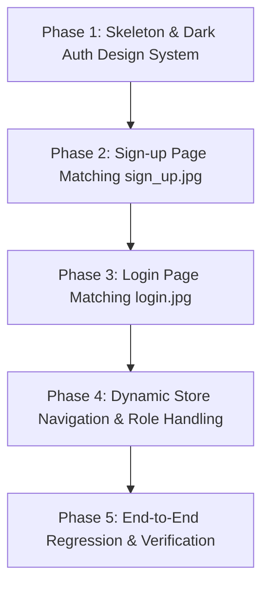

# Walkthrough: Phase 2 Frontend Authentication Implementation

Based on [auth.md](file:///home/fifty/ecommerce/frontend/docs/auth.md), the backend implementation in `backend/app/`, and the exact visual designs in [UI_images/login.jpg](file:///home/fifty/ecommerce/frontend/UI_images/login.jpg) and [UI_images/sign_up.jpg](file:///home/fifty/ecommerce/frontend/UI_images/sign_up.jpg).

---

## 1. Architectural Confirmation & Working Agreement

### Role Redirection & Navigation Logic
* **Unified Landing Page:** There is currently no separate admin dashboard page. After successful authentication, **both customers and admins will redirect to the existing store page (`index.html`)**.
* **Dynamic Role Representation:**
  * **Guest (Unauthenticated):** Displays "Login" and "Sign Up" links in the navbar. The `Admin` button/pill is hidden.
  * **Customer:** Displays `👤 Welcome, <Name>!`, Cart button, and `Logout` button. The `Admin` button/pill is hidden.
  * **Admin:** Displays `👤 Welcome, <Name>!`, `Admin` badge/nav pill, Cart button, and `Logout` button. Backend endpoints continue to enforce authorization.
  * *Future Phase:* The `Admin` button will route to the dedicated admin dashboard once built.

### Progress Tracking Protocol (`auth_tracker.md`)
To maintain strict development visibility and alignment with [auth.md](file:///home/fifty/ecommerce/frontend/docs/auth.md):
* A dedicated tracking document, [auth_tracker.md](file:///home/fifty/ecommerce/frontend/docs/auth_tracker.md), is maintained under `frontend/docs/`.
* **Milestone Update Rule:** Upon completing each phase, `auth_tracker.md` will be updated with:
  1. A concise summary of deliverables completed in that phase.
  2. Verified test behaviors and implementation notes.
  3. Clear identification of what is finished vs. what remains for the next phase.

### Exact Visual Design Guidelines (from `UI_images/`)
Both pages feature a high-end, minimalist dark aesthetic:
* **Background:** Deep black (`#000000` / `#09090b`).
* **Header Tag:** Centered, subtle uppercase category indicator (`LOGIN` / `SIGN UP`) in muted grey (`#71717a`).
* **Headings:**
  * Login: `Welcome back` with subtitle `Sign in to your account`.
  * Register: `Create an account` with subtitle `Enter your details to get started`.
* **Form Inputs:**
  * Background: `#18181b` / `#121214`.
  * Border: `#27272a` (focus ring with subtle white/light glow).
  * Text: `#f4f4f5`, placeholder in `#52525b`.
  * Registration fields: **Username** (maps to `name` in backend schema), **Email**, **Password**.
  * Login fields: **Email**, **Password**, with a right-aligned `Forgot password?` helper link.
* **Primary Action Buttons:**
  * Solid white background (`#ffffff`), dark bold text (`#000000`), full width, rounded corners (`--radius-sm`).
  * Hover state: subtle dimming (`#e4e4e7`).
* **Footer Switcher:** Centered muted text linking between login and register:
  * Login page: `Don't have an account? Sign up`
  * Register page: `Already have an account? Log in`

---

## 2. Confirmed Backend API Contracts

| Item | Confirmed Specification |
| :--- | :--- |
| **API Base URL** | `http://localhost:8000` |
| **Allowed CORS Origins** | `http://localhost:5500`, `http://127.0.0.1:5500`, `http://localhost:3000`, `http://127.0.0.1:3000` |
| **Register Endpoint** | `POST /auth/register` (Content-Type: `application/json`) |
| **Register Request Body** | `{"name": "...", "email": "...", "password": "..."}` *(min length 8 for password)* |
| **Register Response** | HTTP `201 Created` with `UserResponse` (`id`, `name`, `email`, `role="customer"`) |
| **Register Conflict** | HTTP `409 Conflict` (`{"detail": "Email is already registered."}`) |
| **Login Endpoint** | `POST /auth/login` (Content-Type: `application/json`) |
| **Login Request Body** | `{"email": "...", "password": "..."}` |
| **Login Response** | HTTP `200 OK` with `{"access_token": "...", "token_type": "bearer"}` |
| **Login Failure** | HTTP `401 Unauthorized` (`{"detail": "Invalid email or password"}`) |
| **Current User Endpoint** | `GET /auth/me` with header `Authorization: Bearer <access_token>` |
| **Current User Response** | HTTP `200 OK` with `{"id": int, "name": str, "email": str, "role": "customer" | "admin"}` |
| **Token Storage** | `localStorage` (`ecommerce_token` and `ecommerce_user`) |

---

## 3. Project File Structure

```text
ecommerce/
├── backend/                       # FastAPI application (Already completed)
│   └── app/
│       ├── auth/                  # POST /auth/login, POST /auth/register, GET /auth/me
│       └── users/                 # Models & roles (customer / admin)
│
└── frontend/
    ├── UI_images/                 # Visual design reference mockups
    │   ├── login.jpg              # Exact dark theme mockup for login
    │   └── sign_up.jpg            # Exact dark theme mockup for registration
    │
    ├── docs/
    │   ├── auth.md                # Architecture & requirements reference
    │   ├── walkthrough.md         # Step-by-step roadmap
    │   └── auth_tracker.md        # [NEW] Phase-by-phase progress & status tracker
    │
    ├── index.html                 # Phase 1 store page (to be made auth-aware in Phase 4)
    ├── pages/
    │   ├── login.html             # [NEW] Phase 3: Exact dark theme login page
    │   └── register.html          # [NEW] Phase 2: Exact dark theme sign up page
    ├── css/
    │   ├── style.css              # Existing store styles
    │   └── auth.css               # [NEW] Phase 1: Dark theme styling matching UI_images
    └── js/
        ├── app.js                 # Existing store logic (Phase 4: sync auth navbar state)
        ├── auth.js                # [NEW] Phase 1: Shared auth state & API utilities
        ├── login.js               # [NEW] Phase 3: Login form handling & redirect
        └── register.js            # [NEW] Phase 2: Sign-up validation & registration
```

---

## 4. Phase-by-Phase Roadmap



---

### Phase 1: Skeleton Setup & Shared Foundation

The goal of this phase is to set up file scaffolding, build the central auth manager, initialize `auth_tracker.md`, and implement the sleek dark styling system derived from the UI images.

#### Step 1.1: File Creation & Tracker Initialization
* Create directory `frontend/pages/`.
* Initialize `frontend/docs/auth_tracker.md` with the tracking template and Phase 1 objectives.
* Create the following files:
  * `frontend/pages/login.html`
  * `frontend/pages/register.html`
  * `frontend/css/auth.css`
  * `frontend/js/auth.js`
  * `frontend/js/login.js`
  * `frontend/js/register.js`

#### Step 1.2: Central Authentication Helper (`frontend/js/auth.js`)
* Define base URL: `const API_BASE_URL = "http://localhost:8000";`.
* **Token Operations:**
  * `getToken()`: Read `ecommerce_token` from `localStorage`.
  * `setToken(token)`: Store `ecommerce_token`.
  * `removeToken()`: Remove `ecommerce_token`.
* **User Profile Operations:**
  * `getCurrentUser()`: Read and parse `ecommerce_user` from `localStorage`.
  * `setCurrentUser(user)`: Store JSON serialized `ecommerce_user`.
  * `fetchCurrentUser()`: Execute `GET /auth/me` with `Authorization: Bearer <token>`. If HTTP `401`, automatically call `clearAuth()`.
  * `clearAuth()`: Purge token and user profile.
  * `logout(redirectUrl = '../index.html')`: Clear auth state and route user to store page.
* **API Wrapper:**
  * `authFetch(endpoint, options)`: Wrapper injecting auth headers and handling errors.

#### Step 1.3: Dark Theme Styling System (`frontend/css/auth.css`)
Match the visual style of [login.jpg](file:///home/fifty/ecommerce/frontend/UI_images/login.jpg) and [sign_up.jpg](file:///home/fifty/ecommerce/frontend/UI_images/sign_up.jpg):
* **Viewport:** Centered layout on pure black `#000000` background.
* **Auth Container:** Max-width ~400px, responsive padding, vertically and horizontally centered.
* **Top Category Tag:** Uppercase, tracking/letter-spacing, small muted text (`#71717a`).
* **Typography:** Bold white titles (`#ffffff`), muted secondary descriptions (`#a1a1aa`).
* **Input Elements:** Dark fields (`#18181b`), subtle borders (`#27272a`), white text, placeholder `#52525b`, smooth focus ring.
* **Buttons:** High-contrast solid white button with bold black text, hover opacity transition, disabled loading state.
* **Alert Notifications:** Sleek dark dismissible alert boxes for errors (red accent) and success (green accent).
* **Footer Switcher:** Subtle grey text with underlined anchor link.

#### Step 1.4: Phase 1 Review & Tracker Update
* Log completed deliverables in `frontend/docs/auth_tracker.md`.
* Document status: Phase 1 Complete, Phase 2 Ready.

---

### Phase 2: Sign-Up Experience (UI & API Integration)

The goal of this phase is to build the exact registration interface shown in [sign_up.jpg](file:///home/fifty/ecommerce/frontend/UI_images/sign_up.jpg) and wire it to the FastAPI backend.

#### Step 2.1: Semantic HTML (`frontend/pages/register.html`)
Build layout strictly matching `sign_up.jpg`:
* Category Tag: `<span class="auth-tag">SIGN UP</span>`
* Heading: `<h1 class="auth-title">Create an account</h1>`
* Subtitle: `<p class="auth-subtitle">Enter your details to get started</p>`
* Form Fields:
  * **Username** (`id="usernameInput"`, placeholder `username`, required)
  * **Email** (`id="emailInput"`, placeholder `email@example.com`, type `email`, required)
  * **Password** (`id="passwordInput"`, placeholder `••••••••`, type `password`, required, minlength `8`)
* Notification Area (`id="alertBox"`, hidden by default)
* Submit Button: `<button type="submit" id="registerBtn" class="btn-auth-primary">Sign Up</button>`
* Switcher Link: `Already have an account? <a href="login.html">Log in</a>`
* Back to Store link: `← Back to Store` linking to `../index.html`

#### Step 2.2: Sign-Up Form Handling (`frontend/js/register.js`)
* Form submission listener with `e.preventDefault()`.
* **Client-side validation:**
  * Validate username is non-empty.
  * Validate email format with regex.
  * Validate password is at least 8 characters (matching backend rule).
  * Display inline error message if validation fails.
* **API Integration:**
  * Disable button and show loading state ("Creating account...").
  * Send `POST http://localhost:8000/auth/register` with JSON body:
    ```json
    {
      "name": usernameValue,
      "email": emailValue,
      "password": passwordValue
    }
    ```
* **Response Handling:**
  * **HTTP 201 Created:** Display green alert ("Account created successfully! Redirecting to login...") and redirect to `login.html` after 1.5 seconds.
  * **HTTP 409 Conflict:** Display "Email is already registered. Please log in or use another email."
  * **HTTP 422 Unprocessable Entity:** Show field validation message returned by FastAPI.
  * **Network / Server Error:** Display connection failure message.
* Reset button state in `finally`.

#### Step 2.3: Sign-Up Testing & Tracker Update
* Verify UI matches `sign_up.jpg` in typography, spacing, and colors.
* Test client-side validations (empty inputs, password < 8 characters).
* Test successful account registration (HTTP 201).
* Test duplicate registration attempt (HTTP 409).
* Update `frontend/docs/auth_tracker.md` with Phase 2 test results and mark Phase 2 Complete.

---

### Phase 3: Login Experience (UI & API Integration)

The goal of this phase is to build the exact login interface shown in [login.jpg](file:///home/fifty/ecommerce/frontend/UI_images/login.jpg), authenticate credentials, store tokens, and redirect to `index.html`.

#### Step 3.1: Semantic HTML (`frontend/pages/login.html`)
Build layout strictly matching `login.jpg`:
* Category Tag: `<span class="auth-tag">LOGIN</span>`
* Heading: `<h1 class="auth-title">Welcome back</h1>`
* Subtitle: `<p class="auth-subtitle">Sign in to your account</p>`
* Form Fields:
  * **Email** (`id="emailInput"`, placeholder `email@example.com`, type `email`, required)
  * **Password** (`id="passwordInput"`, placeholder `••••••••`, type `password`, required)
  * Helper link: `<a href="#" id="forgotPasswordLink" class="auth-link-forgot">Forgot password?</a>`
* Notification Area (`id="alertBox"`, hidden by default)
* Submit Button: `<button type="submit" id="loginBtn" class="btn-auth-primary">Sign In</button>`
* Switcher Link: `Don't have an account? <a href="register.html">Sign up</a>`
* Back to Store link: `← Back to Store` linking to `../index.html`

#### Step 3.2: Login Form Handling (`frontend/js/login.js`)
* Form submission listener with `e.preventDefault()`.
* Validate email & password presence.
* Show loading state on button ("Signing in...").
* Send `POST http://localhost:8000/auth/login` with JSON payload `{ email, password }`.
* **Response Handling:**
  * **HTTP 200 OK:**
    * Extract `access_token`.
    * Save token via `auth.setToken(data.access_token)`.
    * Request user profile via `auth.fetchCurrentUser()`.
    * Save user object via `auth.setCurrentUser(user)`.
    * **Redirect to store home:** `window.location.href = "../index.html";` (applies to both customer and admin).
  * **HTTP 401 Unauthorized:**
    * Show alert: "Invalid email or password. Please try again."
  * **Network / Other Error:**
    * Show alert: "Could not connect to server. Please try again later."
* Reset button state in `finally`.
* Optional helper handler on `Forgot password?` to display a helpful message (e.g. "Password reset is not yet configured for this demo").

#### Step 3.3: Login Testing & Tracker Update
* Verify UI matches `login.jpg`.
* Test invalid credentials -> verify 401 error message displays without page crash.
* Test valid customer credentials -> verify token stored, `/auth/me` fetched, redirected to `../index.html`.
* Test valid admin credentials -> verify redirect to `../index.html` with role `"admin"`.
* Update `frontend/docs/auth_tracker.md` with Phase 3 test results and mark Phase 3 Complete.

---

### Phase 4: Dynamic Store Navigation & Role Handling

The goal of this phase is to integrate the authentication state into the existing store page ([index.html](file:///home/fifty/ecommerce/frontend/index.html) and [app.js](file:///home/fifty/ecommerce/frontend/js/app.js)) so both roles are handled cleanly on the single store page.

#### Step 4.1: Update Header Elements in `frontend/index.html`
* Update `<nav class="nav-links">`:
  * Give the existing Admin pill an ID: `<a href="#" id="adminNavLink" class="nav-link admin-pill" style="display: none;">Admin</a>`.
* Update `<div class="nav-user">`:
  * Create Guest Container (`#navGuest`):
    * `<a href="pages/login.html" id="loginNavBtn" class="btn btn-outline">Login</a>`
    * `<a href="pages/register.html" id="registerNavBtn" class="btn btn-primary">Sign Up</a>`
  * Create Authenticated Container (`#navAuth`, hidden by default):
    * `<span id="userGreeting" class="user-info">👤 Welcome, User!</span>`
    * `<button id="logoutBtn" class="btn btn-outline">Logout</button>`
* Include `js/auth.js` in `<script>` tags before `js/app.js`.

#### Step 4.2: Update Store Logic in `frontend/js/app.js`
* Add navigation synchronization function `syncAuthState()`:
  * Read `auth.getToken()`.
  * **If token exists:**
    * Call `auth.fetchCurrentUser()` to validate current session with backend:
      * **On Success:**
        * Hide `#navGuest`, show `#navAuth`.
        * Update `#userGreeting` to `👤 Welcome, ${user.name}!`.
        * Check `user.role`:
          * If `admin`: show `#adminNavLink` (and optional Admin badge).
          * If `customer`: hide `#adminNavLink`.
      * **On Failure (token expired/invalid):**
        * Call `auth.clearAuth()` and display `#navGuest`.
  * **If no token:**
    * Show `#navGuest`, hide `#navAuth`, hide `#adminNavLink`.
* Attach click handler to `#logoutBtn`:
  * Calls `auth.logout()`.
  * Calls `syncAuthState()` to restore guest navbar state instantly.
* Invoke `syncAuthState()` inside `DOMContentLoaded` alongside product catalog loading.
* Confirm that product filtering, searching, and pagination continue functioning without regressions.

#### Step 4.3: Navigation Testing & Tracker Update
* Verify navbar switches seamlessly between guest and authenticated states.
* Verify admin vs. customer navigation differences.
* Update `frontend/docs/auth_tracker.md` with Phase 4 outcomes and mark Phase 4 Complete.

---

### Phase 5: End-to-End Regression & Verification

The goal of this phase is comprehensive verification of the full authentication lifecycle.

#### Step 5.1: Functional Test Matrix
* [ ] **Registration Flow:** Open `pages/register.html` -> Verify dark UI matching `sign_up.jpg` -> Register account -> Verify HTTP 201 -> Auto-redirect to `login.html`.
* [ ] **Customer Login Flow:** Enter customer credentials -> Verify dark UI matching `login.jpg` -> Verify HTTP 200 -> Lands on `index.html` -> Navbar displays `Welcome, <Customer Name>!`, Cart, and Logout -> `Admin` pill is HIDDEN.
* [ ] **Customer Logout:** Click Logout -> Navbar immediately switches to Login / Sign Up buttons.
* [ ] **Admin Login Flow:** Enter admin credentials -> Lands on `index.html` -> Navbar displays `Welcome, <Admin Name>!`, Cart, Logout, and `Admin` pill is VISIBLE.
* [ ] **Catalog Integrity:** Ensure product search, categories, and pagination work seamlessly in both guest and logged-in states.

#### Step 5.2: Edge Cases & Security
* [ ] Attempt registration with short password (< 8 chars) -> Handled cleanly.
* [ ] Attempt registration with duplicate email -> Displays 409 conflict notice.
* [ ] Attempt login with wrong password -> Displays 401 unauthorized notice.
* [ ] Tamper with token in `localStorage` -> Reverting cleanly to guest state without console exceptions.
* [ ] CORS & DevServer validation on allowed ports (5500, 3000).

#### Step 5.3: Final Tracker Sign-Off
* Complete all items in `frontend/docs/auth_tracker.md`.
* Formally sign off against the Definition of Done in [auth.md](file:///home/fifty/ecommerce/frontend/docs/auth.md).

---

## Task Summary Table

| Phase | Description | Key Deliverables | Status |
| :---: | :--- | :--- | :---: |
| **Phase 1** | Dark Theme Setup & Auth Foundation | `pages/`, `css/auth.css`, `js/auth.js`, `auth_tracker.md` | Ready to start |
| **Phase 2** | Sign-Up Page (`sign_up.jpg` match) | `pages/register.html`, `js/register.js` | Pending P1 |
| **Phase 3** | Login Page (`login.jpg` match) | `pages/login.html`, `js/login.js` | Pending P2 |
| **Phase 4** | Unified Dynamic Store Navigation | `index.html`, `js/app.js` | Pending P3 |
| **Phase 5** | End-to-End Test & Verification | Final sign-off in `auth_tracker.md` | Pending P4 |
